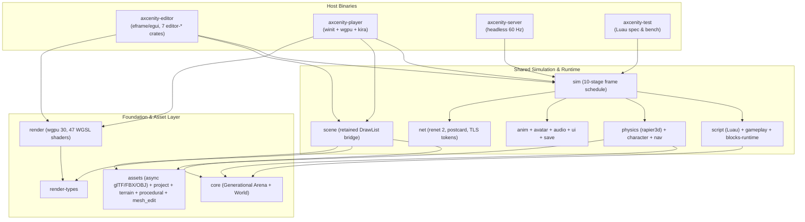

# Architecture Overview

This overview summarizes the verified runtime architecture at `8f4c2420` and cross-references authoritative ADRs in [`wiki/Architecture/Architecture-Decisions/ADR-Index.md`](../../../wiki/Architecture/Architecture-Decisions/ADR-Index.md).

## Architectural Layering & Verified Boundaries

### Enforced Invariants (Verified via `cargo tree` at `8f4c2420`)

| Invariant | ADR | Verification Result |
|---|---|---|
| `axcenity-player` does not depend on `editor`, `egui`, `eframe`, `blocks`, or `plugins` | ADR-0001 | **PASS** (`cargo tree -p axcenity-player`) |
| `axcenity-server` does not depend on `render`, `audio`, `wgpu`, `winit`, `kira`, or `egui` | ADR-0001 | **PASS** (`cargo tree -p axcenity-server`) |
| `axcenity-render` does not depend on `core`, `script`, `scene`, or `physics` | ADR-0003 | **PASS** (`cargo tree -p axcenity-render`) |
| Single-threaded `World` in generational `Arena<Instance>` (no ECS, no `Rc<RefCell>`) | ADR-0002 | **PASS** (workers receive cloned/Arc snapshots only) |
| Unified 10-stage `Schedule` across all 4 hosts with golden-order test | ADR-0006 | **PASS** (`crates/sim/src/golden.rs` asserts order + docs sync) |
| `unsafe_code = "deny"` workspace-wide | Policy | **PARTIAL / DOC DRIFT** — 3 files exempt (`script/src/debugger.rs`, `render/src/adapters.rs`, `release/src/console.rs`); docs only cite `debugger.rs` |

## Data Model & Memory Architecture

- **Entity Storage (`crates/core`)**: `World` stores all entities in `Arena<Instance>` with split ID space (`LOCAL_BASE = 1 << 31`) for local vs. network-replicated IDs and Collaborate ID blocks. Deliberately rejects ECS (ADR-0002); fast queries rely on class and tag indices.
- **Property Representation**: Every `Instance` owns a `BTreeMap<&'static str, Value>` eagerly populated with class defaults (`crates/core/src/world.rs:60,92`) plus a `BTreeMap<String, Value>` for user attributes. Typed property slots (L1) were benchmarked and parked (~9% of S10k instructions).
- **World Lending (`crates/script/src/lent.rs`)**: Zero-allocation `std::mem::swap` lends `&mut World` into Luau callbacks with an unwind-safe RAII `Lend` guard.
- **Asset & GPU Memory**: `Assets` loads meshes/textures asynchronously on 4–8 worker threads (`crates/assets/src/loading.rs`). `render` applies an LRU mip-dropping budget to surface textures (`texture_budget.rs`) and 600-frame eviction to unused meshes/BLASes. **Deficiency**: `Assets::register_identity`, `derived.hidden_models`, `AudioEngine::decoded`, and primary `Assets` caches have no eviction cap.

## Concurrency & Threading Model

- **Main Thread**: Owns `World`, executes `sim::Schedule` stages sequentially, runs Luau coroutines, builds/updates retained `DrawList`, and drives `wgpu` command submission.
- **Bounded Worker Pools**:
  - `physics`: Dedicated Rayon pool (`MAX_THREADS = 12`) serialized via `Mutex<()>` to avoid Rapier broadphase deadlock (`crates/physics/src/threads.rs`).
  - `anim`: Dedicated Rayon pool (`MAX_THREADS = 8`, kicks in at >=8 animators, `crates/anim/src/threads.rs`).
  - `assets`: 4–8 background I/O & decode workers (`crates/assets/src/loading.rs`).
  - `render`: Rayon parallel draw-planning (`crates/render/src/renderer/parallel.rs`).
- **Ad-Hoc Thread Spawning (Debt)**: `nav::SharedNavMesh` spawns a fresh OS thread per rebuild and detaches on drop (`crates/nav/src/shared.rs:49-53`); `terrain::parallel_rows`, `procedural::make_chunks`, and `mesh_edit::bake` spawn scoped OS threads per call; `net::secure` and `collab::socket` spawn a thread per incoming TCP socket.

## Rendering Pipeline Architecture

- **Tiled Forward+ PBR (`crates/render`)**: `wgpu` 30 (DX12, Vulkan, Metal), up to 1,024 lights (64 per 32px tile), 4-cascade sun CSM + spot/point shadows + contact shadows, 47 WGSL shaders (10,410 LOC), custom `naga`-validated `SurfaceShader`s.
- **Shading Models**: Standard, Unlit, Toon, Skin (Penner SSS LUT + makeup masks), Hair (Marschner R/TT/TRT + hashed alpha), Cloth (Charlie sheen + anisotropic GGX). Eye shading is not yet implemented.
- **Compute Posing & Particles**: GPU compute morphing + skinning into a shared 3-buffer arena (2 dispatches/frame, ADR-0041) feeding all passes and RT BLAS; GPU compute particle sim up to 262,144 particles/emitter.
- **GI & Ray Tracing**: Baked/runtime reflection probes, baked light probe volumes, rasterized real-time GI, CPU-BVH software GI (`ray_soft.rs`), and opt-in hardware ray queries (`EXPERIMENTAL_RAY_QUERY`, disabled by default due to RX 9070 XT DX12 flashing).
- **Structural Limit**: No render graph (ADR-0009); `crates/render/src/renderer/scene.rs` is a 3,703-line hand-ordered pass loop, and all 30+ pipelines pass `cache: None` (no disk pipeline cache).

## Networking, Collaborate & Tooling Architecture

- **Multiplayer (`crates/net`, `server`, `relay`)**: Server-authoritative replicas over `renet` 2 / `renet_netcode` UDP + `postcard` binary wire; optional TLS 1.3 TCP token port; self-hostable `axcenity-relay` for NAT hole-punching and UDP/TCP fallback; server-moved character prediction (ADR-0029); lag compensation; world streaming; `.replay` recording.
- **Collaborate (`crates/collab`, `collab-server`, `repo`, `teamwork`)**: Separate TLS 1.3 + WebSocket + Ed25519 operational sync engine with `yrs` (Yjs) live collaborative scripts, content-addressed file sync, deterministic host handoff (ADR-0022), optional Git/GitHub checkpoint sync, and file-backed Team Board.
- **Editor & AI (`crates/editor`, `mcp`, `plugins`)**: Monolithic 257k-LOC `editor` crate (`EditorApp` has 171 fields) undergoing gradual extraction (7 `editor-*` sub-crates extracted so far); Luau Plugin API v3; built-in `rmcp` MCP server over stdio and loopback TCP.
