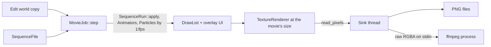

# Specialized editors

The editor's tabs beyond the Scene, Explorer and Properties. Each is a module (often a parent file plus a folder) in `crates/editor/src/` with its actions in `app/<name>.rs`; most keep **their own undo** used while the pointer is over the tab. The usability pass of 2026-11-10 (U*, BL*, UD*, AN*, MS* items in `docs/research/usability/`) reworked several of them.

| Tab | Module | Edits | Saves as | Engine side |
|---|---|---|---|---|
| Model Studio | the `editor-model-studio` crate (G11) | Meshes: modeling ops, modifiers, UVs, paint, rig, weights, pose | `.glb` + `.meshedit.json` sidecar | `mesh_edit` ([Mesh editing and CSG](../Engine-Systems/Mesh-Editing-and-CSG.md)) |
| Animation | `animation.rs`, `animation/` | Clips (dope sheet, curves, Record), state machines (Blueprint-style), posing, IK | `*.anim.json`, `*.statemachine.json` | `anim` |
| Sequencer | `sequencer.rs` | Cutscene sequences on a timeline (reuses Animation's dope sheet and curves) | `*.sequence.json` | `anim::sequence`, `script::sequence` |
| UI Designer | the `editor-ui-designer` crate (G11) | ScreenGuis on an artboard (anchors, rulers, palette, inspector), Event Graph, Live Preview | world + `ui/*.uigraph.json` | `ui`, `blocks-runtime::ui_graph` |
| Material | `material_editor.rs`, `material_graph.rs` | Material files: values, maps, presets, shading, water, WGSL shader, material graph | `*.material.json` (graph compiled to WGSL in the editor) | `render` surface shaders |
| Blocks / Graph | `block_editor.rs`, `block_editor/graph.rs`, the `editor-node-graph` crate | Block scripts as blocks or nodes | `*.blocks.json` | `blocks`, `blocks-runtime` |
| Behavior Tree | `behavior_tree.rs` | Behavior trees on the node-graph editor | `*.behaviortree.json` | `nav::behavior` |
| Dialogue | `dialogue_editor.rs` | Dialogues | `*.dialogue.json` | `script::dialogue` |
| Data Table | `data_table.rs` | Data tables | `*.data.json` | `assets::data_table`, `DataService` |
| Effect | `effect_editor.rs`, `app/effect_tab.rs` (R17.3) | The selected particle effect: a preview of its own (play, loop, slow motion), each emitter's module stack (Properties' rows, the world's undo), counts and costs; R17.5: a Place backdrop with the place's Lighting and wind, and Lighting-aware presets (`scene::EffectPreset`) added as one undo step | `assets/effects/*.prefab.json` (a prefab) | `scene::Particles`, `render` particles |
| Terrain Studio | `terrain_studio.rs`, `terrain_studio/` | Sculpt, paint, generate, erode, layers, biomes, scatter rules | terrain folders | `terrain` |
| Scatter | `scatter_pane.rs`, `app/scatter_pane.rs`, `app/decal_scatter.rs` | A palette of props and models (weight, size, collide, turn, lean, sink, masks) painted onto terrain, and of pictures brushed on as ProjectedDecals | `presets/*.axscatter`; painted foliage in the terrain's `foliage.json`; decals as Instances in `world.json` | `terrain::brush` (`Operation::Scatter`), `procedural::decal_scatter` |

## Character Studio

A workspace of its own, opened from the start screen's Character Studio page with no project ([ADR-0031](../Architecture/Architecture-Decisions/ADR-0031-Character-Studio-Is-A-Workspace-Of-Its-Own.md)): body, face, hair, clothing, skin and makeup, accessories, expressions (preview only) and presets, at three detail levels, on either family (realistic, the default, or stylized), with presets from the library by kind (and a person's own, and favourites), Randomize with scopes and locks, held versions to compare (before and after, side by side, kept or discarded outside undo), asymmetry tools for left and right pairs (mirror or reset a side, one undo step), a pose and motion preview (Still, Idle, Walk, Run, gestures; editor state like an expression), Hair and Clothing browsers (picture tiles of the character wearing each item, search, slot categories, filters, favourites, recently used, drafts only with "Show drafts", a tile previewed on the character until Wear, and the worn item's declared colours, variants and parameters) and autosave with a recovery offer,
 with camera, lighting and backdrop in a bar under a live preview of the default humanoid, posed by the engine's `Animators` in a World of its own (`crates/editor/src/character_workspace.rs`; each area returns `Intent`s that only `character_workspace/shell.rs` applies). The face tools stay a Game Editor tab for placed characters (`crates/editor/src/character_studio.rs`). Its start page (`crates/editor/src/start/characters.rs`) shows Recent, every saved character and preset as a card with a picture (the workspace's preview rendered offscreen on a background thread on the editor's GPU device, cached as PNGs keyed by a hash of the file) and an overview, Edit and Delete, and character packs (plain versioned JSON; exported as one `.characterpack.json`; Add to Project writes their characters to the project's `assets/characters/descriptions/`). Its Clothing page also lists the Axcenity Wardrobe's garments (**Online wardrobe**) and downloads the ones asked for into the studio's library, each file checked by size and SHA-256 ([Toolbox](Toolbox.md#character-packs-the-online-wardrobe)). Behaviour: `docs/editor/character-studio.md`.

## Model Studio

Phase 55–62: a Blender-like mesh editor inside the engine. Its view draws through `View::use_model`. The Pose test skins exactly as `assets::Posed` does. Phase 90 ("A narrower Model Studio") removed Sculpt mode, retopology and Bake (about 5,600 lines); R15 brought Sculpt mode and Bake (with Make Low Poly) back at Paul's choice, and retopology by hand stays Blender's. R15.1 added seven brushes (Layer, Blob, Scrape, Fill, Draw Sharp, Nudge, Elastic Grab) and the Mesh Filter; brushes stay on the `Sculpt`'s fixed vertices (no dynamic topology), so masks, symmetry and chunks keep working. R15.3 added a Levels of detail fold: each level's triangle count, the ratios Generate LODs uses, Regenerate, Remove LODs and Preview LOD 0–2 (`lods.rs`); the renderer still picks levels by size on screen. R15.4's Edit in Blender launches Blender on the `.glb` with a script (Settings > External tools; `editor/src/blender.rs`); Blender's Save exports it back and the Studio offers to load it again.

## Animation tab and sequencer

One Animation tab follows the selected Animator; **Animate** (`EditorApp::animate`) makes an Animator, a clip and an Animation as one undo step. A linked clip's settings end with **Retargeting** (AP3, `animation/retarget_panel.rs`): how the take plays on the preview model, the rig checks, both skeletons' bone maps (saved as reusable rig definitions) and the clip's retarget profile; the preview and Convert to keys bind as Animators do (`ClipDoc::bind_on`). A keyed clip's settings end with **Cleanup** (AP4, `property_editor/cleanup.rs`): Mirror, Smooth, Reduce keys, Fix loop seam and Re-time. Record turns viewport edits into keys. The Sequencer previews in the Scene view through `SequenceRun::apply`, the same code the Sequence Instance runs; its transport adds play backwards, loop, an In/Out play range and edit points (AP5, `transport::sequence_bar`). A picked camera cut has a transition (cut, dissolve, fade through a color), and a sequence keys the sky, the weather, lights and lens effects as well as parts and cameras (`PropertyName::Scene`; `docs/project/sequences.md`). The **Environment** row (2026-11-23, `Row::Environment`) holds keys that each name an environment preset: Add section ▸ Environment key adds one at the playhead, the picked key's inspector sets its preset, its blend to the next key and which way the clock turns, and the preview shows the blend as the playhead moves, through the same `SequenceRun::apply`. The Properties panel's **Environment presets** section (`environment_presets.rs`, `app/environment.rs`; nothing or Lighting selected) applies a preset to the edited world or saves its look as a project preset, one undo step each ([Lighting and atmosphere](../Engine-Systems/Lighting-and-Atmosphere.md#environment-presets)).

### Render Movie

The Sequencer's **Render Movie** (`crates/editor/src/movie.rs`, `movie/`, `app/movie.rs`; `docs/editor/movie.md`) draws the open sequence frame by frame into a video file or a folder of PNGs. It replaced one-off tools written for a showcase film.

- **Offline, on a fixed step.** A `MovieJob` owns a copy of the world, a `SequenceRun`, Animators, Particles and a `TextureRenderer` of its own on the editor's GPU device. Each kept frame moves everything on by `1 / fps` whatever drawing took and reads no clock, so two runs give the same frames. The app steps it for 30 ms of each editor frame, so the editor stays usable.
- **The same code as the preview and the game.** The frame is `SequenceRun::apply` and `scene::build_draw_list_posed`, so cuts, keys, clips and the overlay (fades, bars, subtitles) are what the Sequencer's preview shows. Only a movie draws a dissolve: two renderers for the overlapping frames, their pictures mixed on the CPU.
- **History across cuts.** `TextureRenderer::forget_history` (new with this) drops TAA's picture, the motion vectors' last frame and the fog grid at each cut, and a few thrown-away frames follow, as at the movie's start (the warm-up, which also lets ray traced light and uploads settle).
- **No encoder in the engine.** Video goes through the machine's `ffmpeg` executable (`std::process`, raw frames on its input), found on `PATH` or by `AXCENITY_FFMPEG`, and the formats offered come from its `-encoders` listing. A PNG sequence (the `png` crate) needs nothing. This keeps video codecs and their licences out of the workspace's dependencies.
- **Headless.** `axcenity-editor --render-movie` runs the same job with a device of its own.

## UI Designer

Lays one ScreenGui out on an artboard (`ui::layout_artboard`), with several selected, drag-to-reparent in the Hierarchy, X/Y/W/H boxes and a beginner-first inspector (usability PRs #44, #48, #52). Its Event Graph tab compiles to the ScreenGui's `EventGraph` LocalScript ([Blocks and graphs](../Engine-Systems/Blocks-and-Graphs.md)).

## Terrain Studio

Three tabs, Sculpt, Materials and Terrain, each with its tools and the sections that go with them; the tab shown follows the held tool however it was picked (`TerrainStudio::pick`); generation and erosion run as `terrain::job`s on a worker with progress and cancel. Hand-painted foliage moved to the Scatter pane.

## Scatter

A pane opened from the ribbon's Models group: a per-project palette of props and models picked from the Assets panel (`Picking::Scatter`), each with its share of the mix, size range, collide, turn, lean and sink, and a brush (size, density per 100 square studs, spacing, erase everything). Paint arms the brush through the same viewport plumbing as a terrain brush (`TerrainBrush`, `TerrainPointer`); arming it puts a terrain tool down and the other way round. A stroke is one terrain undo step ("Scatter N Items", "Erase Scatter"). It edits the world's undo, not its own. See `docs/editor/scatter.md`.

Since 2026-11-23: each item has **Masks** (folded; noise patches, slope, height, moisture from the terrain's shape: [Terrain](../Engine-Systems/Terrain.md)); a button makes a **Ground Clutter** palette (small built-in rocks that lie to the slope and sink); and the palette holds **decals**, pictures picked from Assets (`Picking::ScatterDecals`) that **Paint decals** lays with the same brush as ProjectedDecals in a "Scattered Decals" Folder, Shift taking them away. A decal stroke changes Instances, not terrain data, so it keeps the world as it was when it began (`DecalStroke::before`) and records one whole-world step when it ends (`History::record_world`), as a TerrainPath's Apply does. The brush follows the terrain through parts; decals lie on it or, with Land on parts, on the first surface under a point 20 studs up. It has a budget from `Quality::decal_limits` (Medium's 128 within 150 studs by default, else Ultra's), because the renderer draws only the nearest projected decals and none at Low: [Known limitations](../Roadmap/Known-Limitations.md).

## Shared pieces

- **One node-graph editor** (the `editor-node-graph` crate) serves block Graph view, UI Event Graphs, behavior trees, dialogues and material graphs. Since Phase 91 every graph view (those five, plus the block Graph view and the Animation state machine) draws on one canvas, `editor-node-graph`'s `canvas.rs`: pan and zoom, box select, the same keys (F frames, Space searches, Ctrl+D duplicates, Ctrl+C/X/V copy and paste as text, Delete, Escape), pins, wires, the minimap and notices. The editor's `graph_keys_tests.rs` drives the same keys through all five views.
- **Preview canvases** (`animation::preview::Canvas`) run a small World through `scene` so previews draw what Play draws.

## Related documentation

The `docs/editor/*.md` files named above; the usability research in `docs/research/usability/` (`usability-audit.md`, `model-studio.md`, `block-editor.md`, `ui-designer.md`, `design-system.md`, `verification.md`); [Editor architecture](Editor-Architecture.md)
