# Animation

> [!summary]
> `anim` plays **one clip type** (`*.anim.json`: property tracks, bone keys, an optional linked take from an FBX or glTF file) through **Animators** running **state machines** (`*.statemachine.json`) with transitions, 1D blend trees, 2D blend spaces (Delaunay), layers with masks, root motion and events; then **AnimationTracks** over them, **runtime IK** (`IKControl`, foot placement), and **ragdolls** blending in and out. Posing is on the CPU; skinning is on the **GPU** (graphics Phase 14). Cutscene **sequences** share `SequenceRun::apply` between the editor preview, the Sequence Instance and the editor's Render Movie; a camera cut can take over with a transition (a fade through a color drawn by the overlay everywhere, a dissolve handed to hosts as `Applied::dissolve` and drawn only by a rendered movie), and a sequence's tracks also key the sky, weather, lights and lens effects (`PropertyName::Scene`). **Implemented.**

## Execution flow

```mermaid
flowchart LR
  F[FBX or glTF rig + takes<br/>assets::model/rig.rs] --> C[Clip: bind take + bone tracks to rig<br/>by name, or by humanoid role: retarget.rs]
  SM[statemachine.json] --> M[Compiled machine + layers]
  subgraph AN["Animators::update (frame step: animators)"]
    R1[runner per animated thing] --> R2[state machine: transitions,<br/>blend tree / blend space, layers]
    R2 --> R3[AnimationTracks and played Animations<br/>over it, latest start wins]
    R3 --> RS["LiveIdentity::settle: the identity's<br/>bone changes (Model::settle if baked);<br/>then body sliders"]
    RS --> R4[IKControls, FootPlacement<br/>via character::foot_ground]
    R4 --> R5[ragdoll pose override, blend back]
    R5 --> R6["twist.rs: twist and helper bones<br/>turned by name, last"]
    R6 --> R7["correctives.rs: pose-driven shapes<br/>set on the posed skin"]
    R7 --> R8["LiveIdentity::dress: identity shape weights<br/>and joint corrections, last"]
  end
  C & M --> R1
  R6 --> PO["Poses (per MeshPart joint matrices)"]
  PO --> S[scene::build_draw_list_posed] --> G["render posing.rs (CO8):<br/>morphs and skins once a frame on the GPU"]
```

- Live state (`AnimatorState`, `AnimationTrackState`, `PropertyAnimationState`) is in the World, not saved properties.
- Property tracks animate Parts, Model pivots and UI elements; reduced motion (a game UI setting) holds GUI animations.
- A take for another humanoid skeleton (Mixamo on an Unreal mannequin, Blender, Biped …) is **retargeted** (G16, `retarget.rs`): bones are matched to 52 humanoid roles (22 body, 30 finger; AP1) by a fitting **rig definition** (`assets/rigs/*.rig.json`, reusable bone maps found by fit, `Assets::rig_definitions`) or by name, the body's facing and up are measured in both rest poses, and each mapped bone's world turn from its rest is carried over; the hips' travel is scaled by leg length. Name binding still wins whenever any humanoid bone binds by name, with one exception since Character Studio overhaul CO4 (`reshapes` in `crates/anim/src/clip.rs`): a take that keys bone offsets, made on a skeleton that rests at other offsets than the model's (a role's bone more than 5% different) in the same pose (arms within 10 degrees), plays through roles, so the model keeps its own bone lengths. Base models that share bone names and differ in proportions take each other's clips this way: until 2026-11-25 it was how the starter animations, keyed on the stylized skeleton, played on the realistic body. Both bodies are gone ([ADR-0050](../Architecture/Architecture-Decisions/ADR-0050-The-Engine-Ships-One-Character-Family-MakeHumans-Body-With-Quaterniuss-Animations.md)), and the starter animations are now baked on the human base's own skeleton and bind by name (below). Such a take moves role bones only, and plays without matching rest poses (they already match), so the model keeps its own bones' rest directions as well as their lengths. `check_rig`/`check_pair` report missing or misplaced roles, swapped sides, rest pose (T/A) and finger coverage before binding. A clip's link can name a **retarget profile** (`*.retarget.json`, AP2): match rest poses (T-pose takes on A-pose models, on by default), hips Scaled/Unscaled/InPlace, plant feet and match hands with two-bone IK, finger strength, per-role weight and offset.
- Debugging (AP6): `Model::pose` also keeps each bone's posed origin (`Posed::bones`), which the viewport's **Skeletons** overlay draws (rest skeletons from `Rig::skeleton` while editing); `Animators::inspect` is a read-only snapshot of one runner (state, fade, layers, tracks over it, parameters, the last 8 things it fired, root motion) for the editor's Debug > Animator Inspector.
- `Posed::primitive` skins on the CPU only on request (tests, tools, the Model Studio's pose test), per LOD level.
- **The starter animations** ([ADR-0049](../Architecture/Architecture-Decisions/ADR-0049-The-Starter-Animations-Are-Quaterniuss-Library-Baked-Onto-The-Humanoid-Skeleton.md), changed the same day by [ADR-0050](../Architecture/Architecture-Decisions/ADR-0050-The-Engine-Ships-One-Character-Family-MakeHumans-Body-With-Quaterniuss-Animations.md); `assets/characters/human/animations.py`, `mocap.py`): the default humanoid's `HumanoidAnimations.glb` holds 86 takes on the human base's own skeleton. They are the 84 takes of Quaternius's Universal Animation Library 1 and 2 (CC0), baked offline from Unreal's mannequin skeleton, and the walk and the jog again with root motion: each bone turns as far as its counterpart turns from its rest, with the limbs lined up to the library's rest, the hands by their whole frame, the collarbones by where the library's point against its chest from its standing pose, and the hips riding so the lower foot is where the library's is. `animations.py` rebuilds the skeleton out of `HumanParts.glb` and `mocap.py` bakes onto it, so a clip binds to the body by bone name and nothing is retargeted at run time (`anim` `the_starter_animations_play_on_the_human_bases_own_skeleton`). `Idle` is the library's idle. The default state machine has a state for each of the 84 library takes and no other (`STATES` in `crates/project/src/default_humanoid.rs`); its Walk and Run states play the library's Run and Sprint takes. A state whose take doesn't loop goes back to Idle when it has played, holds its last frame (a pose to stay in: an aim, lying dead), or goes on to the state the library made the take to lead into or to be played from (`End::GoesTo`: `Jump` to `Fall`, `SitDown` to `Sit`, a pistol shot back to `PistolIdle`; fifteen of them, each pair checked by `project` `a_state_goes_on_to_the_state_its_take_ends_in`). The fifteen takes keyed on the stylized rig were retired with it on 2026-11-25, so the motions the library lacks are gone: walking and running backward and sideways, Wave, Point, Use, Pull, Climb, Cheer, Clap and Shrug.
- **Followers** (default humanoid HD4, `Animators::follow`): a skinned MeshPart inside a posed one with no runner of its own takes its pose by bone name and is placed by its skeleton (`place_follower` writes its Size, Position and Orientation when they differ), so modular parts on one skeleton wear as one character from one Animator; a part swaps by `MeshId`. Since Character Studio overhaul CO3 each of a follower's blend shapes also takes, every frame, the weight of the leader's shape of the same name from the leader's finished pose (`same_shapes` maps the two models' shapes by name, kept per pair of models), so brows and lashes blink with the face; shapes the leader hasn't got keep the follower's own weight. A leader must be posed to lead: an Animator with nothing to play still poses its MeshPart at rest when that MeshPart has MeshPart children (`leads` in `update_one`), so a still character's parts are placed, and the character applier gives a `Body` with no Animator one ([Characters](Characters.md#applying-a-description-character-runtime)).
- **Live identity: settle and dress** (refinement R2a, [ADR-0041](../Architecture/Architecture-Decisions/ADR-0041-Shared-Base-Mesh-With-Live-Identity-Morphs-Baking-Is-Optional.md), which supersedes [ADR-0038](../Architecture/Architecture-Decisions/ADR-0038-Identity-Is-Baked-Into-Derived-Models-Named-By-MeshId.md)): a character's MeshParts draw their base model's shared mesh and name the identity they wear in the attribute `Identity` ([Characters](Characters.md#applying-a-description-character-runtime)). `anim` works out once per model and identity how it wears it (`Model::live` → `LiveIdentity`, `crates/assets/src/model/identity.rs`), kept in `LiveIdentities` (`crates/anim/src/live_identity.rs`; one not asked for in the last two frames is let go once more than 1,024 are kept, and the limit grows with a crowd in use, so a frame never remakes one it needs). `LiveIdentity::settle` adds the identity's bone changes (the feminine frame's joints, wider-set eyes) right after the clips (`pose_of`) in both posing paths of `crates/anim/src/animators.rs`, before body sliders, the ragdoll, IK, the feet and the face. `LiveIdentity::dress` runs last: in the private `skinned` it sets the identity shapes' weights and multiplies each posed joint by its correction (`Posed::rebind`: the bind re-seated on the changed skeleton, and the surface carried by bones of layers the model has no shape of); a follower takes its leader's weights by name first, then dresses in its own identity (the body's, plus an item's own parameters). Clips made for the base skeleton therefore play unchanged on every character. Identity shapes are morphed every frame in every render pass until CO8. `Model::settle` remains only for a baked (derived) model (`gameplay::description::bake`), whose identity shapes are in its vertices; a model with neither is left alone. When the applier changes a body's model for one with another fit, `ragdoll::refit` (`crates/anim/src/ragdoll.rs`) rewrites the MeshPart's `Size` and `Position` so its skeleton stays where it stood.
- **Corrective shapes** (CO5, `crates/anim/src/correctives.rs`; the rule is in its module docs and in `docs/rendering/animation.md`): blend shapes a body leans on as a bone turns. A shape's weight follows the twist of its bone's turn from rest about an axis, between two angles. The rules are constants found on a model by shape name (five shapes per shoulder: raised, level, lowered, and the hanging arm swung forward and back for the walk; they were the realistic body's, and no shipped body has them since 2026-11-25); the weight is eased at both ends (smoothstep) so a joint turning through a rule's angles doesn't jolt cloth that carries the shape. They are set in the private `skinned`, after the twist and helper bones and the face's shapes, and stay live whether a character wears its identity live or baked. **Tested** on synthetic models (`correctives::tests`).
- **Twist and helper bones** (CO4, `crates/anim/src/twist.rs`; the rules are in its module docs and in `docs/rendering/animation.md`): bones a skeleton has for its skin's sake, which no clip keys. They are found by name (`Left` or `Right`, then `UpperArmTwist`, `LowerArmTwist`, `UpperLegTwist`, `LowerLegTwist`, `ShoulderHelper`, `ElbowHelper`, `HipHelper` or `KneeHelper`). A twist bone takes a share of a twist about its limb's length, so a turned forearm or thigh doesn't wind its skin up; a helper sits on a hinge and turns half as far as it, so a bent joint keeps its width. There is one call site, the private `skinned` in `crates/anim/src/animators.rs`: after the clips, `Model::settle`, body sliders, IK, the feet and the ragdoll, and before the skin is posed, in the pose the caller keeps, so followers get the bones by name. A skeleton with none of these bones is untouched. The human base ([Characters](Characters.md#the-human-base-body-makehuman)) has the eight twist bones, weighted from the halves MakeHuman splits each limb into, and no helper bones: the helper rules were exercised by the realistic body, removed on 2026-11-25, and keep their synthetic tests.
- **Body sliders and sockets** (HD4): attributes on a skinned MeshPart (`BodyHeight`, `LegLength`, `ArmLength`, `ShoulderWidth`, `WaistWidth`, `HipWidth`, `HeadSize`, `HandSize`, `FootSize`) reshape the pose by humanoid role before IK; each bone's own scale goes into its joint matrix only (`Model::pose_shaped`), so children don't shear. Attachments with a `Bone` attribute follow that bone (sockets), and a part with an Attachment named like one is placed on it (accessories).

## Dependencies

`anim`: `core`, `assets`. Easing curves are shared with TweenService (`anim::ease`) and UI transitions.

## Performance

**Measured** (graphics Phase 14, RX 9070 XT): GPU skinning cut 20 walking characters' CPU draw time from 4.85 to 0.38 ms and mesh memory from 13 to 2.3 MB (149 batches → 22); vertex-heavy scenes pay ~5% for wider instances. CPU posing of 20 simple characters is 0.05 ms. S10k's 20 animated characters cost 0.12 ms in Animation (9950X3D).

## Testing

`crates/anim/src/tests.rs` (canonical example files round-trip), `layer_tests.rs`, `retarget_tests.rs` (with CO4's `a_take_named_like_a_body_of_other_proportions_keeps_that_bodys_bones` and `the_starter_animations_play_on_the_human_bases_own_skeleton`), the tests in `twist.rs` (12), `animators/inspect_tests.rs`; player `skinning_tests.rs`, `ragdoll_tests.rs`, `cutscene_tests.rs`; editor animation tests (the Animation tab).

## Limitations

- Format 1 clip files still read (converted).
- No motion matching: proposal only (`docs/research/motion-matching.md`, MM1–MM6; inertialization and a controller trajectory first, the database when there's a licensed dataset).
- Ragdolls can overshoot joint limits on hard landings (see [Physics](Physics.md)).
- No GPU posing (state machines and IK run on the CPU each frame).
- Twist and helper bones are found by name alone: no manifest or rig definition field describes which bone reads which, or by what share, so a skeleton with other names for such bones isn't driven.
- Blend shapes (morph targets) are imported (F1) and drawn morphed on the GPU (F2, before skinning; since CO8 once a frame by the posing pass, only shapes with a weight, which every raster pass and hardware ray tracing read). Faces are driven by a `FaceControls` (F3: 48 standard controls through a face profile, eye and jaw bones turned after IK, in the pose its followers take, so a character's own `Eyes` and `Teeth` parts look and open with the face since CO6) and F4's layers (expressions with priorities and asymmetry, overrides, masks, automatic blinks, gaze at the camera, a target or a point, idle darts; since Character Studio overhaul CO6 a blink closes only what `Eye_Closed`, `Eye_Squint`, `Cheek_Raise` and `Brow_Lower` leave open, by shares measured on the retired realistic head, `BLINK_YIELDS` in `crates/anim/src/face_play.rs`, so a blink during a laugh never carries the upper lid past the lower), and clips and Sequences key face controls (F4b), F5's lip sync (timed visemes through a viseme map, made from phoneme timings or a recording with the Console's `lipsync`), and the Character Studio tab edits faces (F6: profile, controls, shape mapping, expressions, a lip-sync timeline; its preview plays visemes without the sound), faces cost less far off or out of view (F7a facial LOD by `LodDistance`; a whole face still allocates small vectors each frame), but a line keeps time with its Sound only by the game's clock while the Sound plays (a Sound has no play position in the World), and in multiplayer a face's expressions, overrides, layers and lip sync go as targets at the face's `ReplicationRate` (F7b), so devices blend between sends and a lip sync can be up to 0.1 s off the server's. Plan: `docs/research/facial-animation.md` (F4–F7, [ADR-0028](../Architecture/Architecture-Decisions/ADR-0028-Facial-Animation-Morph-Targets-On-GPU-And-FaceControls.md)).
- Sequences have an **Environment track** (2026-11-23): keys that name environment presets, blended in `SequenceRun::apply` (`crates/anim/src/environment.rs`; [Lighting and atmosphere](Lighting-and-Atmosphere.md#environment-presets)). It has no curve view, only a key's easing; a property track on the same property wins.
- Retargeting has rig definitions, fingers (AP1) and profiles (AP2: rest-pose matching, hips travel, planted feet and hand IK, per-role weight and offset). Twist isn't matched between rest poses (only bone directions), and planted feet come from the take's foot travel, not from detected contacts. Bone maps and profiles are edited in the Animation tab's Retargeting section (AP3). Keyed clips have Cleanup tools (AP4, `anim/src/cleanup.rs`): mirror (by the humanoid map and side words, baked a frame apart), smooth, reduce keys, fix the loop seam, re-time a range; they work on keys only, so a linked clip is converted first. The Sequencer's transport adds play backwards, loop, an In/Out play range and edit-point stepping (AP5, `transport::PlayMode`; preview only, never saved). Plan: `docs/research/animation-production.md` (AP6-AP7).

## Development guidance

- Read files through `Assets`; skeletal poses from `Model::pose`.
- Keep example animation files canonical (`to_json` round-trips them).
- The Model Studio's Pose test must skin exactly as `assets::Posed` does.

## Related documentation

`docs/rendering/animation.md`, `docs/scripting/api-animation.md`, `docs/project/animation-files.md`, `docs/project/sequences.md`; [Specialized editors](../Editor/Specialized-Editors.md#animation-tab-and-sequencer)
