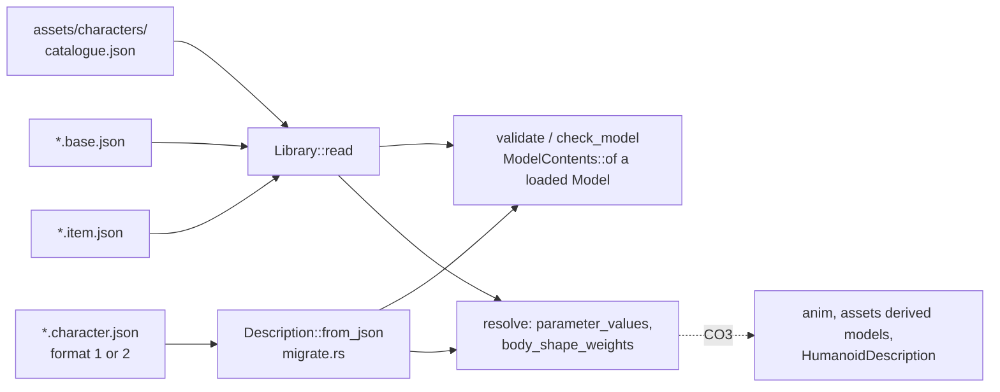

# Character Data

> [!summary]
> The `avatar` crate holds the formats Character Studio and the (planned) Character Runtime share: a character's **description** (`*.character.json` format 2: base model, parameter values, worn items, material values; format 1 migrates), the **base model manifest** (`*.base.json`: what each parameter drives, regions, slots, sockets, materials, skeleton, face), the **item manifest** (`*.item.json`: garments, accessories, grooms), the library's **catalogue** and the **material values** per shading model, with checks and parameter resolution. **Partial:** built in Character Studio overhaul CO1 as contracts; nothing in the engine reads these files yet (the runtime applier is CO3).

## Architecture and flow

- A description holds **values only**: no meshes, no editor state. Its base and items are IDs (`axcenity/tee`) resolved through the library.
- A base manifest's parameters map a value through `from`/`to` spans onto shape weights, bone offsets and scales, body attributes (`anim`'s body sliders) and material values; corners multiply several parameters (MakeHuman-style); `max_sum` constraints scale parameters down together.
- The stylized humanoid's manifests are generated by `assets/characters/humanoid/manifests.py` from `Humanoid.customization.json` and `HumanoidParts.glb`; the catalogue by `assets/characters/catalogue.py`.

## Dependencies

`assets` only (for `ModelContents::of`), plus `serde`, `serde_json`, `thiserror`. It must never depend on rendering, UI, Instances or the editor, so `player`, `server` and `editor` can all link it. Dev-dependents today: `project` and `editor` (agreement tests).

## Performance

Not measured: files are small JSON and resolution is a few loops per parameter. The runtime cost the overhaul cares about (identity bake, morph cost) arrives with CO3 and CO8.

## Testing

`crates/avatar/src/tests/` (round trips, migration, checks, resolution), `crates/avatar/tests/shipped_library.rs` (the repository's library against its models), `project` `the_character_data_manifests_describe_the_default_humanoid`, `editor` `a_saved_look_migrates_to_the_same_parts_and_shapes`. See `docs/development/character-studio/testing.md`.

## Development guidance

- The contract is `docs/development/character-studio/architecture.md`; change it there and in the crate together. Only the overhaul's lead changes a schema.
- An optional field needs no version bump (unknown fields are kept); a changed meaning bumps `format_version` and adds a migration with a test.
- After changing a manifest generator or a model, regenerate the manifests and the catalogue; the contract tests fail when they're stale.

## Related documentation

[ADR-0032](../Architecture/Architecture-Decisions/ADR-0032-Semi-Realistic-Default-Character-Family.md), [ADR-0033](../Architecture/Architecture-Decisions/ADR-0033-One-Character-Description-Read-By-Every-Host.md), [ADR-0034](../Architecture/Architecture-Decisions/ADR-0034-Character-Content-Library-Outside-The-Binaries.md), [ADR-0035](../Architecture/Architecture-Decisions/ADR-0035-Clothing-Fits-By-Surface-Binding-With-Region-Hiding.md), [ADR-0036](../Architecture/Architecture-Decisions/ADR-0036-Character-Shading-Models-With-Modulating-Material-Values.md), [ADR-0037](../Architecture/Architecture-Decisions/ADR-0037-One-Groom-Asset-With-Card-Strand-And-Mesh-Tiers.md); [Animation](Animation.md); [Characters](Characters.md)
