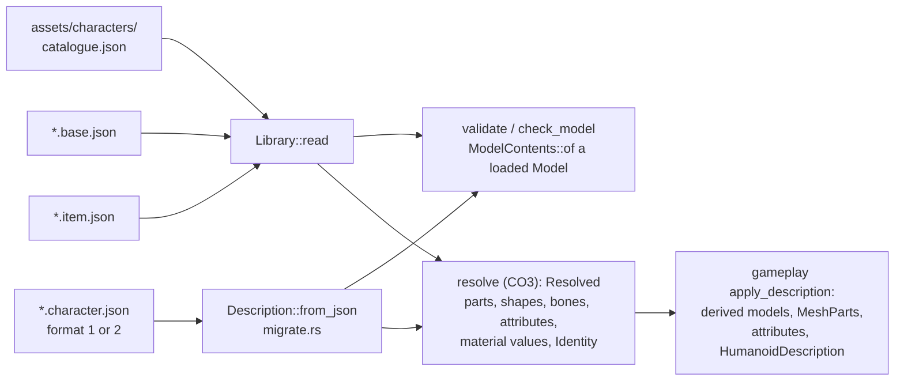

# Character Data

> [!summary]
> The `avatar` crate holds the formats Character Studio and the Character Runtime share: a character's **description** (`*.character.json` format 2: base model, parameter values, worn items, material values; format 1 migrates), the **base model manifest** (`*.base.json`: what each parameter drives, regions, slots, sockets, materials, skeleton, face), the **item manifest** (`*.item.json`: garments, accessories, grooms), the library's **catalogue** and the **material values** per shading model, with checks and resolution. **Partial:** the formats were built in Character Studio overhaul CO1 as contracts. Since CO3 the runtime reads them: `resolve` turns a description into what the applier in `gameplay` writes onto a character ([Characters](Characters.md#applying-a-description-character-runtime)). Character Studio's workspace still writes format 1 and poses its own preview (CO12), and the realistic family and binding-fitted or socket items have no content yet (every shipped item fits by `shapes`).

## Architecture and flow

- A description holds **values only**: no meshes, no editor state. Its base and items are IDs (`axcenity/tee`) resolved through the library.
- A base manifest's parameters map a value through `from`/`to` spans onto shape weights, bone offsets and scales, body attributes (`anim`'s body sliders) and material values; corners multiply several parameters (MakeHuman-style); `max_sum` constraints scale parameters down together.
- The stylized humanoid's manifests are generated by `assets/characters/humanoid/manifests.py` from `Humanoid.customization.json` and `HumanoidParts.glb`; the catalogue by `assets/characters/catalogue.py`.

## What CO3 built on it

- **`resolve(&Library, &Description)`** (`crates/avatar/src/resolve.rs`) returns `Resolved`, everything the applier needs as plain data: the body and the parts worn (the base model's own parts, then one per worn item in the description's order) as `MeshId`s relative to the library folder, each with how it follows the body (`PartFit::Skinned`, or `Socket` with the socket's name) and its material values (the worn item's over its variant's); the body's shape weights; each changed bone's summed offset and scale; the body slider attributes; the base model's material values (the description's over what parameters drive); and `problems`, the items left out and why (not in the library, doesn't fit the base, a slot that holds one item given two: the later one is worn). The only errors are a base model the library hasn't and one whose model file leads out of the library.
- **One identity layer per cause.** `Resolved::identity` is an `assets::Identity` with a layer for each parameter (its shape weights and its bone changes together), each corner and each region mask (at 1 when a worn item hides the region, else 0). The bake decides per layer and per model whether a bone change re-seats a surface that has the layer's shape or carries one that hasn't, which is why a parameter's shapes and bones stay in one layer ([ADR-0038](../Architecture/Architecture-Decisions/ADR-0038-Identity-Is-Baked-Into-Derived-Models-Named-By-MeshId.md)). `Resolved::shapes` is the sum of the layers, so the two can't disagree. A shape named at weight 0 is still an identity shape: it is baked and dropped.
- **`LIBRARY_FOLDER`** (`assets/characters`) is where a project's library is. `gameplay::description::library` reads it there, and `project::add_character_library` writes the engine's built-in package into it (`crates/project/src/character_library.rs`; `add_default_humanoid` calls it, so it arrives with the default character).
- The crate still makes no Instances and loads no models. `avatar` names `assets`' `Identity`, `IdentityLayer` and `BoneChange` types, which is inside its allowed dependencies.

## Dependencies

`assets` only (for `ModelContents::of`), plus `serde`, `serde_json`, `thiserror`. It must never depend on rendering, UI, Instances or the editor, so `player`, `server` and `editor` can all link it. Dependents since CO3: `gameplay` (the applier) and `project` (the built-in library) as normal dependencies; `player` and `editor` as dev-dependencies (their tests).

## Performance

Not measured: files are small JSON and resolution is a few loops per parameter. The identity bake arrived with CO3 (`Model::bake` in `assets`); its cost is **Unverified**: not measured yet (CO18 measures characters). Morph cost is CO8.

## Testing

`crates/avatar/src/tests/` (round trips, migration, checks, resolution; `resolving.rs` covers `resolve`: parts and items, items left out, bones, attributes and materials on the same spans, a layer per cause), `crates/avatar/tests/shipped_library.rs` (the repository's library against its models), `project` `the_character_data_manifests_describe_the_default_humanoid`, `editor` `a_saved_look_migrates_to_the_same_parts_and_shapes` and `a_character_file_applied_in_a_game_matches_the_workspaces_preview`. See `docs/development/character-studio/testing.md`.

## Development guidance

- The contract is `docs/development/character-studio/architecture.md`; change it there and in the crate together. Only the overhaul's lead changes a schema.
- An optional field needs no version bump (unknown fields are kept); a changed meaning bumps `format_version` and adds a migration with a test.
- After changing a manifest generator or a model, regenerate the manifests and the catalogue; the contract tests fail when they're stale.

## Related documentation

[ADR-0032](../Architecture/Architecture-Decisions/ADR-0032-Semi-Realistic-Default-Character-Family.md), [ADR-0033](../Architecture/Architecture-Decisions/ADR-0033-One-Character-Description-Read-By-Every-Host.md), [ADR-0034](../Architecture/Architecture-Decisions/ADR-0034-Character-Content-Library-Outside-The-Binaries.md), [ADR-0035](../Architecture/Architecture-Decisions/ADR-0035-Clothing-Fits-By-Surface-Binding-With-Region-Hiding.md), [ADR-0036](../Architecture/Architecture-Decisions/ADR-0036-Character-Shading-Models-With-Modulating-Material-Values.md), [ADR-0037](../Architecture/Architecture-Decisions/ADR-0037-One-Groom-Asset-With-Card-Strand-And-Mesh-Tiers.md), [ADR-0038](../Architecture/Architecture-Decisions/ADR-0038-Identity-Is-Baked-Into-Derived-Models-Named-By-MeshId.md); [Animation](Animation.md); [Characters](Characters.md)
