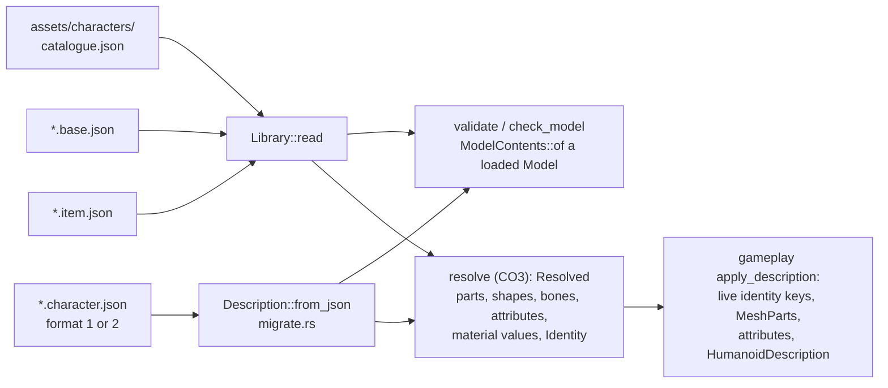

# Character Data

> [!summary]
> The `avatar` crate holds the formats Character Studio and the Character Runtime share: a character's **description** (`*.character.json` format 2: base model, parameter values, worn items, material values; format 1 migrates), the **base model manifest** (`*.base.json`: what each parameter drives, regions, slots, sockets, materials, skeleton, face), the **item manifest** (`*.item.json`: garments, accessories, grooms), the library's **catalogue**, **presets** (`*.preset.json`) and the **material values** per shading model, with checks, resolution and Randomize. **Partial:** the formats were built in Character Studio overhaul CO1 as contracts. Since CO3 the runtime reads them: `resolve` turns a description into what the applier in `gameplay` writes onto a character ([Characters](Characters.md#applying-a-description-character-runtime)). The engine ships one base model, `axcenity/human` (`DEFAULT_BASE`, [ADR-0050](../Architecture/Architecture-Decisions/ADR-0050-The-Engine-Ships-One-Character-Family-MakeHumans-Body-With-Quaterniuss-Animations.md)), and binding-fitted and socket items have no shipped content (every shipped item fits by `shapes`).

## Architecture and flow

- A description holds **values only**: no meshes, no editor state. Its base and items are IDs (`axcenity/tee`) resolved through the library.
- A base manifest's parameters map a value through `from`/`to` spans onto shape weights, bone offsets and scales, body attributes (`anim`'s body sliders) and material values; corners multiply several parameters (MakeHuman-style); `max_sum` constraints scale parameters down together.
- The human base's manifest is generated by `assets/characters/human/manifests.py` from what `build.py` recorded (`Human.build.json`), with the face's parameters, features and handles from `face.py`; its presets by `presets.py`; the catalogue by `assets/characters/catalogue.py`.
- **Which base.** `DEFAULT_BASE` (`crates/avatar/src/migrate.rs`) is `axcenity/human`, the one family the engine ships since 2026-11-25. A character that names no base is on `Library::default_base` (`crates/avatar/src/library.rs`): the engine's when the library has it, else `axcenity/stylized` (an older project's own copy), else the library's first. Format 1 still migrates to `axcenity/stylized` (`V1_BASE`); the engine no longer ships that package, so such a file resolves only where the library has its own copy.

## What R1 added: metadata, capabilities, presets, Randomize

The refinement's shared contracts (plan section 11.3, [ADR-0040](../Architecture/Architecture-Decisions/ADR-0040-Character-Metadata-Item-Capabilities-And-Presets-Are-Data-In-The-Manifests.md)), all optional fields with no version change:

- **Parameter metadata**: `about` (tooltip), `feature`, `level` (`quick`/`detailed`/`advanced`, with `advanced` written in step; `Parameter::level`), `random`. Groups and slots have `about` and `icon`; a slot also `random_drafts` and `hidden_by`; material slots `label`, `values` and `role`. Every one of the human base's 161 parameters has `about` and `level`, written by its `manifests.py` and `face.py`; none names a `feature`, so a parameter's feature is its group.
- **Features and handles**: what a person can point at (`{id, label, category, anchors: [{bone, offset}], radius, regions?}`) and handles that only name parameters. The human base has ten features and 24 handles, all on the face, written by `face.py` (a handle's drives each carry an axis, a travel and the framings they can be dragged in).
- **Item capabilities**: an item's own `parameters`, `also_fills`, `requires`, `excludes`, `limitations`, `adjust` for socket items, variant pictures and parameter values; a worn item's `parameters`, `transform` and kept unknown fields. `resolve` gives an item's part its own shape weights (`ResolvedPart::shapes`) and transform, and leaves out what `also_fills`, `excludes` and `requires` forbid; the applier doesn't bake item shapes yet.
- **Makeup and markings** (R5, [ADR-0042](../Architecture/Architecture-Decisions/ADR-0042-Makeup-And-Markings-Are-Layers-Over-Library-Masks-Drawn-Live-By-The-Skin-Model.md); `skin.rs`): a description's optional `skin` block turns on layers the base manifest's `skin_layers` offers (makeup: colour, opacity, roughness; markings: amount, seed, opacity; the human base offers none, and the realistic base that did was removed on 2026-11-25); `resolve` writes them as `layer_<id>_<field>` material values on the layer's skin slot, which the applier sets live like every other value. The masks are content in the model file (`docs/rendering/skin.md`). `skin` presets carry the block.
- **Presets**: a format 2 description with a `preset` block, listed in the catalogue's `presets`; `apply_preset` sets only what its kind owns (`body`, `face`, `hair`, `outfit`, `skin`, `character`, and `feature` for one feature's parameters). The human base ships 30 (`human/presets/`, written by `presets.py`).
- **Randomize**: `randomize(&Description, &Scope, locks, seed, &Library)`, deterministic, inside `random`, with the base's constraints and only compatible items: none made for the other body type than the one drawn (`cut.rs`: the tags `masculine`, `feminine`, `unisex`; `made_for`, `feminine_frame`).

## What CO3 built on it

- **`resolve(&Library, &Description)`** (`crates/avatar/src/resolve.rs`) returns `Resolved`, everything the applier needs as plain data: the body and the parts worn (the base model's own parts, then one per worn item in the description's order) as `MeshId`s relative to the library folder, each with how it follows the body (`PartFit::Skinned`, or `Socket` with the socket's name) and its material values (the worn item's over its variant's); the body's shape weights; each changed bone's summed offset and scale; the body slider attributes; the base model's material values (the description's over what parameters drive); and `problems`, the items left out and why (not in the library, doesn't fit the base, a slot that holds one item given two: the later one is worn). An item in a slot whose `hidden_by` names a filled slot is worn but has no part, hides nothing and is no problem (ADR-0045's amendment of 2026-11-25: the human base's cut underwear under a top or a bottom). The only errors are a base model the library hasn't and one whose model file leads out of the library.
- **One identity layer per cause.** `Resolved::identity` is an `assets::Identity` with a layer for each parameter (its shape weights and its bone changes together), each corner and each region mask (at 1 when a worn item hides the region, else 0). Each model decides per layer whether a bone change re-seats a surface that has the layer's shape or carries one that hasn't, which is why a parameter's shapes and bones stay in one layer. Since R2a the identity is worn **live** on the base meshes ([ADR-0041](../Architecture/Architecture-Decisions/ADR-0041-Shared-Base-Mesh-With-Live-Identity-Morphs-Baking-Is-Optional.md): `Model::live`, weights and joint corrections on each pose), and the bake of [ADR-0038](../Architecture/Architecture-Decisions/ADR-0038-Identity-Is-Baked-Into-Derived-Models-Named-By-MeshId.md) is an optional optimization (`gameplay::description::bake`). `Resolved::shapes` is the sum of the layers, so the two can't disagree. A shape named at weight 0 is still an identity shape: it holds that weight, live or baked. An item's own parameters (`ResolvedPart::shapes`) are worn live on the item's part as one more layer.
- **`LIBRARY_FOLDER`** (`assets/characters`) is where a project's library is. `gameplay::description::library` reads it there, and `project::add_character_packages_for` copies into it what a project's characters name from the library the engine ships beside the program (`crates/project/src/character_library.rs`). No library is built into the program since 2026-11-25; see [Characters](Characters.md#applying-a-description-character-runtime), "The library in a project".
- The crate still makes no Instances and loads no models. `avatar` names `assets`' `Identity`, `IdentityLayer` and `BoneChange` types, which is inside its allowed dependencies.

## Dependencies

`assets` only (for `ModelContents::of`), plus `serde`, `serde_json`, `thiserror`. It must never depend on rendering, UI, Instances or the editor, so `player`, `server` and `editor` can all link it. Dependents since CO3: `gameplay` (the applier) and `project` (a project's library and the default game character) as normal dependencies; `player` and `editor` as dev-dependencies (their tests).

## Performance

Not measured: files are small JSON and resolution is a few loops per parameter. Applying is measured since R2a: a parameter change applies live (no bake) in the times of `docs/development/character-studio/refinement/r2/r2a-live-identity.md`, which also has the frame cost of 1, 10 and 50 distinct characters live and baked. Since CO8 the morph cost is paid once a frame, only for shapes with a weight (`docs/development/character-studio/refinement/wave3/co8-compute-posing.md`).

## Testing

`crates/avatar/src/tests/` (round trips, migration, checks, resolution; `contracts.rs`, `presets.rs` and `randomizing.rs` for R1: new fields round-trip, old files read unchanged, every new check fires, `apply_preset` per kind, 1,000 seeded randomizations sound with locks holding; `resolving.rs` covers `resolve`: parts and items, items left out, bones, attributes and materials on the same spans, a layer per cause), `crates/avatar/tests/shipped_library.rs` (the repository's library, presets and benchmark characters against its models; the human base's skins, hairstyles, face names, features and handles, and its underwear under its clothes), and `editor` `a_character_file_applied_in_a_game_matches_the_workspaces_preview`. `crates/avatar/tests/` held `fitting.rs` and the `realistic_*.rs` tests until 2026-11-25; they were removed with the assets they measured. See `docs/development/character-studio/testing.md`.

## Development guidance

- The contract is `docs/development/character-studio/architecture.md`; change it there and in the crate together. Only the overhaul's lead changes a schema.
- An optional field needs no version bump; a changed meaning bumps `format_version` and adds a migration with a test. Only a description keeps unknown fields (its top level and its worn items); manifests and the catalogue ignore them, and a new value in an existing enum makes an older engine reject the file.
- After changing a manifest generator or a model, regenerate the manifests and the catalogue; the contract tests fail when they're stale.

## Related documentation

[ADR-0050](../Architecture/Architecture-Decisions/ADR-0050-The-Engine-Ships-One-Character-Family-MakeHumans-Body-With-Quaterniuss-Animations.md) (one family; supersedes [ADR-0032](../Architecture/Architecture-Decisions/ADR-0032-Semi-Realistic-Default-Character-Family.md)), [ADR-0047](../Architecture/Architecture-Decisions/ADR-0047-The-Realistic-Family-Is-Rebuilt-On-MakeHumans-Body-And-Wardrobe.md), [ADR-0033](../Architecture/Architecture-Decisions/ADR-0033-One-Character-Description-Read-By-Every-Host.md), [ADR-0034](../Architecture/Architecture-Decisions/ADR-0034-Character-Content-Library-Outside-The-Binaries.md), [ADR-0035](../Architecture/Architecture-Decisions/ADR-0035-Clothing-Fits-By-Surface-Binding-With-Region-Hiding.md), [ADR-0036](../Architecture/Architecture-Decisions/ADR-0036-Character-Shading-Models-With-Modulating-Material-Values.md), [ADR-0037](../Architecture/Architecture-Decisions/ADR-0037-One-Groom-Asset-With-Card-Strand-And-Mesh-Tiers.md), [ADR-0038](../Architecture/Architecture-Decisions/ADR-0038-Identity-Is-Baked-Into-Derived-Models-Named-By-MeshId.md); [Animation](Animation.md); [Characters](Characters.md)
