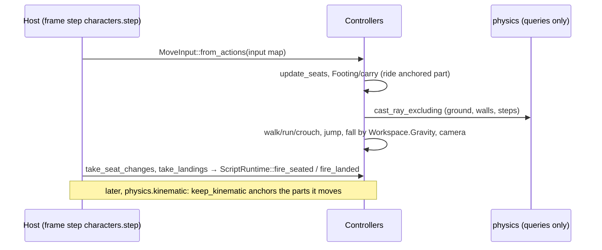
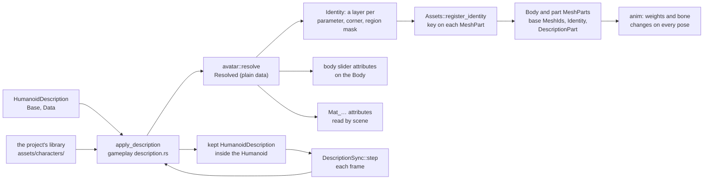

# Characters

> [!summary]
> `character` steps `ThirdPersonController` and `FirstPersonController` Instances (declared in `core`) with the same **kinematic** movement code: ray probes (`physics::cast_ray_excluding`), not a physics body. Walk, run and crouch are built-in modes; jump, slopes and step-up are movement on those modes; a custom `Movement` name hands motion to scripts. It also seats characters (Seats and VehicleSeats), rides anchored moving platforms, and provides the default character rig. Humanoids, Players and spawning live in `script` on top of it. **Implemented.** What a character looks like is separate: the **Character Runtime** (Character Studio overhaul CO3, in `gameplay`, `avatar`, `assets`, `anim` and `scene`) applies a character **description** to a character's Model; see [Applying a description](#applying-a-description-character-runtime). **Built in CO3, pending review** ([ADR-0038](../Architecture/Architecture-Decisions/ADR-0038-Identity-Is-Baked-Into-Derived-Models-Named-By-MeshId.md) is Proposed). The engine ships **one character family**, [the human base](#the-human-base-body-makehuman) on MakeHuman's body ([ADR-0050](../Architecture/Architecture-Decisions/ADR-0050-The-Engine-Ships-One-Character-Family-MakeHumans-Body-With-Quaterniuss-Animations.md)); the realistic and stylized families were removed on 2026-11-25.

## Architecture and flow

- The controller of a Player's `Character`, else the first controller in the Workspace with a body, receives input and owns the camera; others walk their `MoveDirection` (Humanoids).
- A seated character is unanchored and welded to its seat; `keep_kinematic` skips it.

## Applying a description (Character Runtime)

Built in Character Studio overhaul CO3. The contract, field by field, is `docs/development/character-studio/architecture.md` (sections 7, 10, 14 to 17); the formats are [Character Data](Character-Data.md). This is how the pieces run.

- **Resolve.** `apply_description(world, assets, character, description)` (`crates/gameplay/src/description.rs`) reads the project's character library (`library`: `assets/characters/` in the project folder, read once and again when its `catalogue.json` changes) and calls `avatar::resolve` (`crates/avatar/src/resolve.rs`). The result is plain data: the body and the parts worn (the base model's eyes, teeth, brows and lashes, then one per item) as `MeshId`s, the body's shape weights, bone changes, body slider attributes, material values, and the items left out with the reason. A character with no skinned body, or a base model the library hasn't, is an error that changes nothing.
- **Fitting garments a person imports (CO9, [ADR-0035](../Architecture/Architecture-Decisions/ADR-0035-Clothing-Fits-By-Surface-Binding-With-Region-Hiding.md), [ADR-0041](../Architecture/Architecture-Decisions/ADR-0041-Shared-Base-Mesh-With-Live-Identity-Morphs-Baking-Is-Optional.md) decision 4).** No shipped item is fitted this way since 2026-11-25 (every one is a `fit: shapes` item, below); the mechanism stays for imported garments. `avatar::fit` binds a garment made in the body's rest pose to the body (where a ray inward along the garment's normal meets it, or the closest point), carries the skin weights of the skin under it (smoothed over the garment) and every identity and corrective shape onto it as same-named morph targets, and pushes it out of the body and lower layers along their normals at rest, at each shape's full weight and at the sliders check's pairs of build extremes. The result is an ordinary skinned part that follows the body's live weights; nothing is fitted at run time. `import_garment` (and `cargo run -p axcenity-avatar --example import_garment`) aligns a glTF or OBJ garment, classifies its slot from the regions it covers, writes a fitted `.glb`, its binding, a thumbnail and a draft item manifest into a library. A region counts as covered at 99.5% of its triangles, a triangle being under the garment when the garment lies out along its normal or it is in a crease the garment closes over (`coverage::closed_creases`: the armpit under a sleeve); it is hidden only if its skin also stays under the cloth in every fit pose (`pose_safe_hides`, CO9 part 2 review fixes 2: hiding the torso and upper arms under the test tee, a fixture removed with the realistic package, left holes in the walk). `player`'s `fit_gate_tests` measure poke-through on the cast in the body suite's poses, layered pairs (a lower layer through an upper one) and holes (hidden skin out from under the cloth, the same rule); `player`'s `garment_checks` are the helpers a content track calls on its items for asset-quality §3 and §4 in motion and on the feet: `motion` (sampled frames of Idle, Walk and Run: no garment corner jolting past the skin near it, no seam opening, no hair inside the head) and `footwear` (no foot corner out of the shoe, the tread flat on the floor at rest). Both now run on the human base's cast (`human_clothes_cover_the_human_cast`, `the_human_bases_underwear_is_not_drawn_under_an_outfit`, `human_garments_and_hair_stay_steady_in_the_idle`, `_walk` and `_run`); the footwear check is held by a synthetic shoe (`the_footwear_check_finds_a_foot_through_the_sole_and_a_tread_off_flat`).
- **Non-destructive garment fitting (2026-11-24, [ADR-0046](../Architecture/Architecture-Decisions/ADR-0046-Non-Destructive-Proxy-Fitting-And-Biharmonic-Inpainting.md), superseding [ADR-0044](../Architecture/Architecture-Decisions/ADR-0044-Garments-Not-Made-On-The-Body-Come-Through-An-Intake-Before-The-Fit.md)).** Offline fitting (`crates/avatar/src/fit/proxy.rs`, `crates/avatar/src/fit/bind.rs`, `crates/avatar/src/fit/inpaint.rs`, `crates/avatar/src/fit/transfer.rs`, `crates/avatar/src/fit/validate.rs`) never mutates canonical rest geometry: a garment is gated read-only by `validate_garment`, then bound part-restricted to `FitProxy`/`SkirtProxy` on their `HomeFrame` (`Masculine` or `Feminine`) with `faer` biharmonic skin-weight and frame-relative morph-delta inpainting. The Blender prep pass for generated garments (`prep_meshy_garments.py`) and the garments it prepared were removed with the realistic package on 2026-11-25, so no shipped asset exercises this path ([ADR-0050](../Architecture/Architecture-Decisions/ADR-0050-The-Engine-Ships-One-Character-Family-MakeHumans-Body-With-Quaterniuss-Animations.md)); its unit tests stay (`crates/avatar/src/fit/tests.rs`).
- **What is worn hides what is under it (2026-11-24, [ADR-0045](../Architecture/Architecture-Decisions/ADR-0045-What-Is-Worn-Over-Skin-Or-Cloth-Hides-It-By-A-Cover-Map.md), amended by [ADR-0046](../Architecture/Architecture-Decisions/ADR-0046-Non-Destructive-Proxy-Fitting-And-Biharmonic-Inpainting.md)).** Every import writes a **cover map** (`crates/avatar/src/fit/cover.rs`) over the body's UV space and `_AXCENITY_SKIN_UV` per corner, culling covered skin and inner cloth non-destructively at runtime (`Model::without_covered`). For bulky inner layers, `fit_garment` generates one non-destructive `Shrink_Under` morph target toward Layer Envelope `layer - 1`, activated live by `avatar::resolve` only when an overlapping higher-layer garment is equipped.
- **Shipped garments follow the body by their own shapes.** Every shipped garment and hairstyle is a `fit: shapes` item converted from MakeHuman's clothes ([the human base](#the-human-base-body-makehuman)): its shapes are made at build time and nothing is fitted or solved at run time. The realistic wardrobe (garments drafted from sewing patterns and garments made with Meshy, fitted by `avatar::fit`) was removed with its base on 2026-11-25 ([ADR-0050](../Architecture/Architecture-Decisions/ADR-0050-The-Engine-Ships-One-Character-Family-MakeHumans-Body-With-Quaterniuss-Animations.md)).
- **Live identity (refinement R2a, [ADR-0041](../Architecture/Architecture-Decisions/ADR-0041-Shared-Base-Mesh-With-Live-Identity-Morphs-Baking-Is-Optional.md)).** The resolved `Identity` has one layer per parameter, corner and region mask. The applier registers it in `Assets` (`Assets::register_identity`, by `Identity::key`) and writes its key on the body and every part as the attribute `Identity`; every MeshPart keeps its base model's `MeshId`, so all characters of a family share one mesh. A part with item parameters wears the body's identity plus a layer of the item's own shapes. `anim` works out once per model and identity how it wears it (`Model::live` → `LiveIdentity`, `crates/assets/src/model/identity.rs`; cached in `crates/anim/src/live_identity.rs`), adds its bone changes after the clips and puts its shape weights and per-joint corrections (re-seated binds, carried surfaces) on the pose last. A parameter change is a new key and new weights: no mesh is copied. **The bake is optional**: `gameplay::description::bake` gives each MeshPart the derived model of [ADR-0038](../Architecture/Architecture-Decisions/ADR-0038-Identity-Is-Baked-Into-Derived-Models-Named-By-MeshId.md) (`…#AxcenityHuman/Body#i<key>`, `Assets::derive`, `crates/assets/src/derived.rs`) and draws the same pixels; nothing calls it by default, a baked character stays baked where it is loaded, and applying a description makes it live again.
- **Parts.** The character's `Body` MeshPart takes the base body's `MeshId`, kept where the old model's skeleton stood (`anim::ragdoll::refit`). Each part is a MeshPart inside the `Body`, named after its object, not colliding and massless, with the attribute `DescriptionPart`. Parts already worn are kept (and keep their pose), parts no longer worn are destroyed, and MeshParts without the attribute are the creator's own and left alone, except that one named like a library part is taken over (the default humanoid's own parts). They follow the body as any follower does ([Animation](Animation.md)). An item on a socket gets an Attachment named after the socket, so `anim`'s sockets hang it; the base model's sockets the body lacks are added.
- **Attributes.** Body slider values (`BodyHeight` and the rest) are number attributes on the `Body`; one at 1 isn't written unless it undoes an earlier value. A slider attribute this base model doesn't drive, left on the `Body` by another base model, is set back to 1 (`anim::BODY_SLIDERS`).
- **An Animator.** Something must pose the body for its parts to be placed on it, so a `Body` with no Animator is given one. An Animator with nothing to play poses its MeshPart at rest when that MeshPart has MeshPart children ([Animation](Animation.md)), so a character standing still wears its parts in place.
- **Material values.** Each value is an attribute `Mat_<material>_<value>` (`crates/core/src/material_values.rs`; a number or a `Color3`) on the MeshPart whose model has the material: the base model's on the body and its own parts, an item's on its part. Values a description no longer has are removed. `scene` reads them when it builds the part's draw items (`modulate` in `crates/scene/src/material.rs`), so the material's maps stay ([ADR-0036](../Architecture/Architecture-Decisions/ADR-0036-Character-Shading-Models-With-Modulating-Material-Values.md)): `melanin`, `undertone` and `redness` tone the base colour by one ratio in linear light along a pigment curve (`crates/scene/src/skin_tone.rs`, the skin references' tone table interpolated in optical density; all three 0 is exactly the authored colour); then `tint`, `iris_tint` and `sclera_tint` multiply it; `roughness_scale` multiplies the roughness and `detail_strength` the normal map's strength. Free per item: no new texture, binding or bind group beyond a distinct normal strength. The other values are stored and wait for the renderer's shading models (CO7). Tests: `scene`'s `material_values_tests` and `skin_tone`. The player's `skin_value_tests`, captures of the realistic body, were removed with it on 2026-11-25.
- **The kept description.** What was applied stays in the World as a `HumanoidDescription` inside the character's Humanoid (named `AppliedDescription` inside a character without one), so it is saved and replicated like any Instance. An `Identity` key only means something to a run that has registered its identity, so `DescriptionSync::step` applies every kept description under the Workspace that this run hasn't applied, or whose `Base` or `Data` changed since. `DescriptionSystem` (`crates/gameplay/src/description_system.rs`) steps it every frame from the game systems' step in the script step (on each side; the second finds nothing left to do) and reports a description it can't apply once. Until that step runs, the character draws its base meshes with no identity.
- **Scripts** reach all of it through `HumanoidDescription`'s methods, `Humanoid:ApplyDescription`, `Humanoid:GetAppliedDescription` (a copy) and `Players:CreateHumanoidModelFromDescription` (a copy of the StarterCharacter with the description applied): `docs/scripting/api-character.md`.
- **The library in a project** ([ADR-0050](../Architecture/Architecture-Decisions/ADR-0050-The-Engine-Ships-One-Character-Family-MakeHumans-Body-With-Quaterniuss-Animations.md)). No library is built into the program. The engine's packages are a folder beside it, `assets/characters/` with a `catalogue.json`, found by `project::shipped_character_library` (the working folder, then beside the program and in each folder above it). A project gets what its characters name and not the whole shipped library, which is about 300 MB: `project::add_character_packages_for` (`crates/project/src/character_library.rs`) copies each given description's base (its model, region map and the colour maps its materials can draw), the items it wears, the base's default items and what its body types put on, file by file where the shipped file is missing or differs; a project's own files and IDs are left alone. New projects from the character templates and Insert ▸ Character call `project::add_default_game_character` (`crates/project/src/game_character.rs`): it copies the human base with what the default game character wears (`add_game_character_library`), writes the default humanoid's files (`add_default_humanoid`, which writes no library) and writes the `Character` prefab as a described character (`project::described_character`: the default humanoid's Model with a `HumanoidDescription` on `axcenity/human` in its Humanoid, wearing `DEFAULT_GAME_OUTFIT`: MakeHuman's shirt and jeans, brown shoes and a short hairstyle), keeping an older project's prefab. Character Studio's Done and Add to Project copy the same way; the studio's own folder takes the whole library (`project::add_character_packages`, which also brings an older copy up to date file by file). Without the shipped folder (a program run away from its files) the default character is the default humanoid's own model, the default body in its underwear, with no description to change it by. An older project keeps the stylized or realistic packages its own library has, and nothing brings those up to date any more. The Game Editor's round trip (Edit in Character Studio, Done as one undo step) and its edit mode, which applies kept descriptions and poses described characters at rest with no game system (OPEN-21), are in `docs/editor/character-studio.md`.

## The human base body (MakeHuman)

`axcenity/human` is the one base model family the engine ships ([ADR-0050](../Architecture/Architecture-Decisions/ADR-0050-The-Engine-Ships-One-Character-Family-MakeHumans-Body-With-Quaterniuss-Animations.md); built on 2026-11-24 by [ADR-0047](../Architecture/Architecture-Decisions/ADR-0047-The-Realistic-Family-Is-Rebuilt-On-MakeHumans-Body-And-Wardrobe.md), the only family since 2026-11-25) and the default (`avatar::DEFAULT_BASE`; a character that names no base is on `Library::default_base`). It is in the repository's `assets/characters/human/` folder: MakeHuman's base mesh and targets (CC0) on the humanoid bone names plus eight twist bones (the manifest's `skeleton.added_bones`), built by scripts that drive the MPFB Blender add-on as a tool (`build.py`, `mh.py`; no MPFB code is in the repository). The manifest is `Human.base.json`, the model `HumanParts.glb` (the body `AxcenityHuman/Body` and the parts `Eyes`, `Teeth`, `Tongue`, `Brows`, `Lashes`), the region map `HumanRegions.png`. The package's `README.md` has the build, the licence gate and what is missing.

- **Body.** The body type (`frame`: Male or Female, a choice that wears its own underwear, with a slider for a frame between the two since 2026-11-25: `Parameter::between`), `muscle`, `fat` and `age` with shapes, and nine proportion sliders (height, leg and arm length, shoulder, waist and hip width, head size, and since 2026-11-25 hand and foot size). Its underwear (boxer briefs, a bandeau top) is cut from the body's own surface (`underwear.py`).
- **Face.** 149 identity parameters made from MakeHuman's own slider list, with hand-written names in three levels, ten face features, 24 handles and 30 expression shapes named after the standard facial controls (`face.py`; the built-in `axcenity` face profile plays them). Thirteen of the 48 standard controls have no shape behind them.
- **Presets.** 30 (`presets.py`): the Male and Female characters, six bodies, eight faces, and as `feature` presets (`avatar::PresetKind::Feature`, which set one feature's parameters and nothing else) seven face shapes and seven noses.
- **Skin.** One of MakeHuman's 22 photographed skins, kept as images beside the manifest (`skins/`, 11 MB) and not in the model file ([ADR-0048](../Architecture/Architecture-Decisions/ADR-0048-A-Base-Models-Material-Draws-A-Library-Colour-Map-Chosen-By-The-Characters-Parameters.md), `skins.py`). The manifest lists each with the parameter values it was made for (`material_maps`), `resolve` picks the nearest (`Resolved::colour_maps`), the applier names it on the body as `Mat_Skin_colour_map` and `scene::material::colour_map` draws it in place of the file's colour map, keeping the rest of the material. A person picks one thing, the `skin` choice on the Skin and Makeup page (African, Asian, Caucasian, a second Caucasian pair, a painted bodysuit that Randomize never draws); the sex of the skin follows the body type and its age the Age slider (young up to a quarter of it, old from three quarters). `Skin` is on the Skin shading model with tone controls, and between two ages it draws a mix of the two photographs (a map's `blend`, `Resolved::colour_blends`, `Mat_Skin_colour_map_toward` and `_amount`, `render::SkinShading::second_colour`). Brows and lashes are on the Hair model.
- **Wardrobe.** The MakeHuman community's clothes, converted by `wardrobe.py`: each garment is a `fit: shapes` item whose shapes are what its clothes file makes of the body's (so it follows every slider with nothing fitted at run time), with a cover map and its corners' places on the skin. The cover map has all three of [ADR-0045](../Architecture/Architecture-Decisions/ADR-0045-What-Is-Worn-Over-Skin-Or-Cloth-Hides-It-By-A-Cover-Map.md)'s channels: red from the body corners the file hides, green where its cloth lies over the skin (so what is worn beneath it, the base's cut underwear first, is left out there), blue for a top tucked into a bottom; a converted garment under another is cut and its edge sunk as one the engine fitted, and the cut underwear wears `Shrink_Under` while anything is over it. The repository holds **51 garments**, every CC0 item of the converted library (`take_library.py` takes an item only when the converter's report and the item's own manifest both say CC0 1.0); the library's CC BY garments stay outside the repository. Author and licence are in each item's `source` and in `CREDITS.md`. Every item is a draft.
- **Hair.** MakeHuman's hairstyles, converted by `hair.py` as its clothes are: a `groom` item in the `hair` slot whose mesh carries the body's and the face's shapes (not the expression shapes), drawn by the Hair shading model with MakeHuman's painted texture cut out by its alpha, with colour variants that move the painted colour along the pigment curve or dye it. All **ten** are in the repository. A new character in Character Studio is bald; Randomize draws the hairstyles (the hair slot's `random_drafts`).
- **Features and handles (refinement R2).** The manifest's ten features and 24 `handles` are all on the face. A handle is a point of the skin that Character Studio draws on the selected feature and drags: it names the parameters it moves, each with an axis and a travel read from the shapes (`face.py`). The player's `handle_tests.rs` holds every anchor to the skin at rest, every handle to the applied skin at its parameters' ends and every drive to its measured travel. Picking a feature reads the skin as drawn: `scene`'s `ray_parts` and `ray_model` (`crates/scene/src/surface_pick.rs`) test a ray against each part posed, skinned and morphed with its live identity (the CPU skinning `Posed::primitive` keeps per pose). Where a body's file carries its regions per corner in its second texture coordinates, `assets` reads them into `Primitive::regions` and the hit reports its region; the human base's body has no second texture coordinates. The studio draws only what the camera sees: the posed character (its body, then each part it wears) is rasterized on the CPU into a buffer of the viewport that keeps each texel's nearest triangle (`crates/editor/src/character_workspace/direct/depth.rs`). The highlight is a soft mask read from it (`direct/mask.rs`), a handle is hidden only by skin, and a worn item carries the weights of the skin under it (`direct/worn.rs`, `WornMap`), so a feature is lit and picked on the cloth over it ([ADR-0045](../Architecture/Architecture-Decisions/ADR-0045-What-Is-Worn-Over-Skin-Or-Cloth-Hides-It-By-A-Cover-Map.md), amended 2026-11-24). The studio's side is `docs/editor/character-studio.md`, "Editing on the character".
- **The default humanoid's model.** `Humanoid.glb` in the same folder is the base's default body made light enough to build into the program (`default_model.py`, plain Python: the body, its face parts and the boxer briefs on the same 64 bones, with the 30 face control shapes kept and the other shapes dropped, 4.7 MB against the base model's 30 MB). `project` embeds it (`crates/project/src/default_humanoid.rs`): it is what a character is drawn as before its description is applied, and where a project has no character library. The starter animations beside it (`HumanoidAnimations.glb`, `animations.py`, `mocap.py`) are baked on the same skeleton ([Animation](Animation.md)).
- **What no shipped asset exercises.** The realistic base was the only content for some engine features, which keep their code and synthetic tests: corrective shapes and helper bones (`anim`), makeup and marking layers ([ADR-0042](../Architecture/Architecture-Decisions/ADR-0042-Makeup-And-Markings-Are-Layers-Over-Library-Masks-Drawn-Live-By-The-Skin-Model.md)), the Skin model's defined normal map, eye and iris values, per-corner body regions, a character's levels of detail, body features and handles, and `avatar::fit` end to end on a shipped body. The human base has none of them.

## The realistic base body

Removed on 2026-11-25 ([ADR-0050](../Architecture/Architecture-Decisions/ADR-0050-The-Engine-Ships-One-Character-Family-MakeHumans-Body-With-Quaterniuss-Animations.md), which supersedes [ADR-0032](../Architecture/Architecture-Decisions/ADR-0032-Semi-Realistic-Default-Character-Family.md)), with the stylized humanoid ([ADR-0030](../Architecture/Architecture-Decisions/ADR-0030-Smooth-Stylized-Humanoid-On-CC0-Base-Meshes-With-Mask-Shapes.md)): the packages `axcenity/realistic` and `axcenity/stylized`, their build scripts, wardrobes, presets, benchmarks, the shape-transfer tools and the tests that measured them are gone from the repository, whose history keeps them. The realistic base was built in Character Studio overhaul CO4 to CO6 on Blender Studio's Human Base Meshes; what it measured is still in `docs/development/character-studio/` (`co4/`, `co5/`, `co6/`, `refinement/`).

What that means now:

- A format 1 character file still migrates to `axcenity/stylized` (`avatar::V1_BASE`, `crates/avatar/src/migrate.rs`). The engine no longer ships that package, so such a file opens on the default character with a notice unless the library has its own copy.
- An older project's library keeps its own copies of the removed packages, and its characters still resolve against them. Character Studio offers such a body only when its library has it (the Family row is drawn for two or more bases).

## Dependencies

`core`, `anim` (seat `Sit` state), `assets`, `physics`. **`physics` must never depend on it**; `nav` may. The Character Runtime is not in the `character` crate: the applier is in `gameplay`, which depends on `avatar` for it; `avatar` itself makes no Instances.

## Performance

**Measured** (S10k, 9950X3D): Characters was 2.70 ms with one player character (ray probes against 10,000 parts); after L4's kept query bounds the test runner's Characters step is 0.31 ms (cloud container). See [Optimization log](../Performance/Optimization-Log.md#l4-query-bounds).

## Testing

`crates/character/src/tests.rs`, `tests/seat.rs`; player tests `seat_tests.rs`, `vehicle_tests.rs`, `spawn_tests.rs`, `humanoid_tests.rs`, `default_humanoid_tests.rs` (the default humanoid asset). The Character Runtime: `avatar` `tests::resolving`; `assets` `model::identity::tests` and `derived::tests`; `crates/gameplay/src/description_tests.rs` (changing a description, and scripts doing it on both sides); the player's `default_humanoid_tests/description.rs` (parts worn, identity worn live and changed by weights only, item parameters as live weights, eyes carried by the frame's bones, an explicit bake within 0.2 mm of the live character, body sliders, material values, a kept description applied again) and `default_humanoid_tests/description_lua.rs`; the editor's `a_character_file_applied_in_a_game_matches_the_workspaces_preview` (the applier and Character Studio's preview put every corner in the same place, to 0.2 mm, with no derived `MeshId`); direct manipulation (R2): `scene`'s `surface_pick` tests (a ray at a known point of the posed body hits within 1 mm, the identity's weights change the hit, a miss is none), `assets`' region map tests, `avatar`'s `the_human_bases_face_has_readable_names_features_and_handles` (`crates/avatar/tests/shipped_library.rs`), the player's `handle_tests.rs` (every anchor on the skin at rest; every handle the data predicts within 2 mm of the applied skin at its parameters' ends; every travel within 5% of the applied skin's) and the editor's `character_workspace::handle_tests` (a handle's drag and the sliders give the same description for each of seven face features, one undo step, camera drags change nothing, Symmetry moves the mirror); the capture's `an_explicit_bake_draws_the_same_pixels_as_the_live_character`. Visual QA: `crates/player/src/character_capture.rs` draws a character from a description file with the player's renderer (six fixed cameras, two lighting presets; the `capture_characters` tool), the same input giving the same pictures; beside the fixed set, added for the refinement and drawn only when named: the `warm`, `cool` and `outdoor` lights, the `face-three-quarter`, `face-side` and `skin-close` views, four held QA poses and the `face` and `body` suites (a sheet per character). The benchmark characters are `assets/characters/benchmarks/` (written by its `make.py`), all on the human base: bodies at the sliders' ends, a cast of representative people, hairstyles and outfits for each body type (`docs/development/character-studio/visual-qa.md`). `crates/avatar/tests/shipped_library.rs` holds the shipped library, its presets and the benchmarks to their models. The tests of the removed families went with them on 2026-11-25 ([ADR-0050](../Architecture/Architecture-Decisions/ADR-0050-The-Engine-Ships-One-Character-Family-MakeHumans-Body-With-Quaterniuss-Animations.md)): `avatar`'s `tests/fitting.rs` and `realistic_*.rs`, the player's `wardrobe_tests`, `makeup_tests`, `skin_value_tests` and `hair_tests`, and the Blender measurements of the realistic body, whose numbers stay in `docs/development/character-studio/co4/measurements.json`.

## Limitations

Since CO8 (2026-11-17) the renderer morphs and skins each character once a frame, walking only the shapes with a weight, and every pass and ray tracing read that posed copy: live identity costs once, not per pass (1, 10, 20 and 50 characters before and after in `docs/development/character-studio/refinement/wave3/co8-compute-posing.md`; 50 live take 1.5 ms of GPU against 9.6 ms before), and ray-traced shadows, ambient occlusion, reflections and hardware GI show identity and expression shapes. Registered identities are kept for the run, one per drag step since the drag throttle went. The rest of the Character Runtime's limits (edit mode poses at rest only, values not drawn until CO7, no content yet for binding-fitted and socket items) are in [Known limitations](../Roadmap/Known-Limitations.md#characters).

## Development guidance

- Never change physics settings from here; fall by `physics::gravity(world)`.
- A new movement feature works in both controllers (only `Eye` and `pose_camera` differ).
- A character with a root part (its Model's `PrimaryPart`, else `HumanoidRootPart`) is measured by that part alone (`root_part`, `Body::rooted`): walls, ground, steps, crouch and feet use its box, every part still moves and turns with it, and a crouch squashes only it. That keeps a skinned mesh in an A-pose from widening the body.
- The default character is the skinned default humanoid (`project::default_character`, stage HD3 of `docs/research/default-humanoid.md`). Since 2026-11-25 its model is the human base's default body (`assets/characters/human/Humanoid.glb`, [ADR-0050](../Architecture/Architecture-Decisions/ADR-0050-The-Engine-Ships-One-Character-Family-MakeHumans-Body-With-Quaterniuss-Animations.md); before that the smooth stylized humanoid of [ADR-0030](../Architecture/Architecture-Decisions/ADR-0030-Smooth-Stylized-Humanoid-On-CC0-Base-Meshes-With-Mask-Shapes.md)): an invisible `HumanoidRootPart` (the 0.30 m capsule's box, 0.86 × 5 studs) with the `Body` MeshPart welded to it, not colliding. Insert ▸ Character in a saved project and new projects from the character templates (StarterCharacter `assets/prefabs/Character.prefab.json`) use it **wearing the default game character's description** (applied by the Character Runtime; the bare model, in its underwear, when the engine's library isn't found), and older projects keep their own prefab; the six welded blocks (`rig.rs`) remain for unsaved projects and an empty StarterCharacter. Known gap: in first person the camera sits inside the head, whose eyeballs can show.

## Related documentation

`docs/scripting/api-character.md`; `docs/development/character-studio/architecture.md`; [ADR-0007](../Architecture/Architecture-Decisions/ADR-0007-Fixed-Step-Physics-And-Kinematic-Characters.md); [ADR-0033](../Architecture/Architecture-Decisions/ADR-0033-One-Character-Description-Read-By-Every-Host.md); [ADR-0038](../Architecture/Architecture-Decisions/ADR-0038-Identity-Is-Baked-Into-Derived-Models-Named-By-MeshId.md); [ADR-0047](../Architecture/Architecture-Decisions/ADR-0047-The-Realistic-Family-Is-Rebuilt-On-MakeHumans-Body-And-Wardrobe.md); [ADR-0050](../Architecture/Architecture-Decisions/ADR-0050-The-Engine-Ships-One-Character-Family-MakeHumans-Body-With-Quaterniuss-Animations.md); [Character Data](Character-Data.md); [Gameplay systems](Gameplay-Systems.md); [Physics](Physics.md); [Animation](Animation.md)
