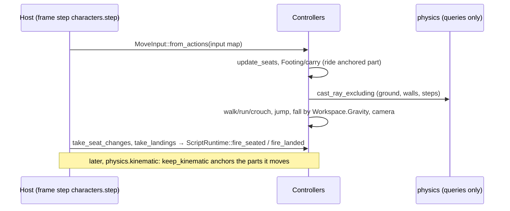
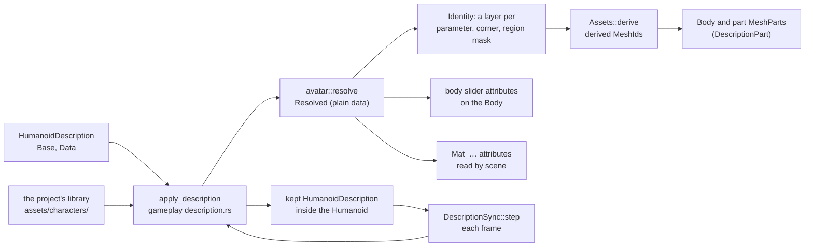

# Characters

> [!summary]
> `character` steps `ThirdPersonController` and `FirstPersonController` Instances (declared in `core`) with the same **kinematic** movement code: ray probes (`physics::cast_ray_excluding`), not a physics body. Walk, run and crouch are built-in modes; jump, slopes and step-up are movement on those modes; a custom `Movement` name hands motion to scripts. It also seats characters (Seats and VehicleSeats), rides anchored moving platforms, and provides the default character rig. Humanoids, Players and spawning live in `script` on top of it. **Implemented.** What a character looks like is separate: the **Character Runtime** (Character Studio overhaul CO3, in `gameplay`, `avatar`, `assets`, `anim` and `scene`) applies a character **description** to a character's Model; see [Applying a description](#applying-a-description-character-runtime). **Built in CO3, pending review** ([ADR-0038](../Architecture/Architecture-Decisions/ADR-0038-Identity-Is-Baked-Into-Derived-Models-Named-By-MeshId.md) is Proposed). A second base model, [the realistic base body](#the-realistic-base-body), is **built in CO4 and waits for review**; it is not yet a family characters are made from.

## Architecture and flow

- The controller of a Player's `Character`, else the first controller in the Workspace with a body, receives input and owns the camera; others walk their `MoveDirection` (Humanoids).
- A seated character is unanchored and welded to its seat; `keep_kinematic` skips it.

## Applying a description (Character Runtime)

Built in Character Studio overhaul CO3. The contract, field by field, is `docs/development/character-studio/architecture.md` (sections 7, 10, 14 to 17); the formats are [Character Data](Character-Data.md). This is how the pieces run.

- **Resolve.** `apply_description(world, assets, character, description)` (`crates/gameplay/src/description.rs`) reads the project's character library (`library`: `assets/characters/` in the project folder, read once and again when its `catalogue.json` changes) and calls `avatar::resolve` (`crates/avatar/src/resolve.rs`). The result is plain data: the body and the parts worn (the base model's eyes, teeth, brows and lashes, then one per item) as `MeshId`s, the body's shape weights, bone changes, body slider attributes, material values, and the items left out with the reason. A character with no skinned body, or a base model the library hasn't, is an error that changes nothing.
- **Derived models.** The resolved `Identity` has one layer per parameter, corner and region mask. `Assets::derive` registers it and gives each model's derived `MeshId` (`…#AxcenityHumanoid/Body#i<key>`); `Assets` bakes the model the first time something asks for it (`crates/assets/src/model/identity.rs`, `crates/assets/src/derived.rs`). The body and every part are derived with the same identity, so a part's own copies of the body's shapes are baked at the body's weights, and characters with the same description share their meshes. Why a `MeshId`: [ADR-0038](../Architecture/Architecture-Decisions/ADR-0038-Identity-Is-Baked-Into-Derived-Models-Named-By-MeshId.md).
- **Parts.** The character's `Body` MeshPart takes the body's derived `MeshId`, kept where the old model's skeleton stood (`anim::ragdoll::refit`). Each part is a MeshPart inside the `Body`, named after its object, not colliding and massless, with the attribute `DescriptionPart`. Parts already worn are kept (and keep their pose), parts no longer worn are destroyed, and MeshParts without the attribute are the creator's own and left alone, except that one named like a library part is taken over (the default humanoid's hand-placed parts). They follow the body as any follower does ([Animation](Animation.md)). An item on a socket gets an Attachment named after the socket, so `anim`'s sockets hang it; the base model's sockets the body lacks are added.
- **Attributes.** Body slider values (`BodyHeight` and the rest) are number attributes on the `Body`; one at 1 isn't written unless it undoes an earlier value. A slider attribute this base model doesn't drive, left on the `Body` by another base model, is set back to 1 (`anim::BODY_SLIDERS`).
- **An Animator.** Something must pose the body for its parts to be placed on it, so a `Body` with no Animator is given one. An Animator with nothing to play poses its MeshPart at rest when that MeshPart has MeshPart children ([Animation](Animation.md)), so a character standing still wears its parts in place.
- **Material values.** Each value is an attribute `Mat_<material>_<value>` (`crates/core/src/material_values.rs`; a number or a `Color3`) on the MeshPart whose model has the material: the base model's on the body and its own parts, an item's on its part. Values a description no longer has are removed. `scene` reads them when it builds the part's draw items (`modulate` in `crates/scene/src/material.rs`): `tint` and `iris_tint` multiply the base colour and `roughness_scale` the roughness, so the material's maps stay ([ADR-0036](../Architecture/Architecture-Decisions/ADR-0036-Character-Shading-Models-With-Modulating-Material-Values.md)). The other values are stored and wait for the renderer's shading models (CO7).
- **The kept description.** What was applied stays in the World as a `HumanoidDescription` inside the character's Humanoid (named `AppliedDescription` inside a character without one), so it is saved and replicated like any Instance. A derived `MeshId` only means something to a run that has registered its identity, so `DescriptionSync::step` applies every kept description under the Workspace that this run hasn't applied, or whose `Base` or `Data` changed since. `DescriptionSystem` (`crates/gameplay/src/description_system.rs`) steps it every frame from the game systems' step in the script step (on each side; the second finds nothing left to do) and reports a description it can't apply once. Until that step runs, a derived `MeshId` draws its base model.
- **Scripts** reach all of it through `HumanoidDescription`'s methods, `Humanoid:ApplyDescription`, `Humanoid:GetAppliedDescription` (a copy) and `Players:CreateHumanoidModelFromDescription` (a copy of the StarterCharacter with the description applied): `docs/scripting/api-character.md`.
- **The library in a project.** `project::add_character_library` (`crates/project/src/character_library.rs`) writes the engine's built-in package (the stylized humanoid's manifests, `HumanoidParts.glb` and a catalogue) into a project's `assets/characters/`, keeping files already there. `project::add_default_humanoid` calls it first, so the library arrives with the default character: a new project with a character, Insert ▸ Character, Character Studio's workspace folder and the visual QA capture's stage. A project made before CO3 has none until Insert ▸ Character is used, and a packed game from such a project has none ([Known limitations](../Roadmap/Known-Limitations.md#characters)).

## The realistic base body

Built in Character Studio overhaul CO4, with its body parameters from CO5, waiting for review ([ADR-0032](../Architecture/Architecture-Decisions/ADR-0032-Semi-Realistic-Default-Character-Family.md)). The package's own README, beside its files in the repository's `assets/characters/realistic/` folder, describes the build; the contract is `docs/development/character-studio/architecture.md` (sections 6 and 12).

- **What it is.** The base model family `axcenity/realistic`: the manifest `Realistic.base.json` and the model `RealisticParts.glb`, with the skeleton `AxcenityRealistic`, the body `AxcenityRealistic/Body`, the parts `Eyes`, `Teeth` and `LipSeal` (the depth the closed lips touch over), and two simpler copies of the body (`Body_LOD1`, `Body_LOD2`) and of the teeth (`Teeth_LOD1`, `Teeth_LOD2`). Its 14 body regions are stored twice, as the index map `RealisticRegions.png` and as the body's `TEXCOORD_1` ([ADR-0035](../Architecture/Architecture-Decisions/ADR-0035-Clothing-Fits-By-Surface-Binding-With-Region-Hiding.md); nothing is hidden by them until CO9). Its `build.py` makes all of it from Blender Studio's Human Base Meshes v1.4.1, which are CC0.
- **Skeleton.** The 56 bones of the humanoid convention, named as the stylized humanoid's are, plus 16: eight twist bones and eight helper bones, listed in the manifest's `skeleton.added_bones`. No clip keys them; `anim` turns them by name just before the skin is posed ([Animation](Animation.md)).
- **Clips.** The starter animations were made on the stylized skeleton, whose bones have the same names and other lengths. `anim` plays such a take through humanoid roles, not by name, so the realistic body keeps its own proportions ([Animation](Animation.md)).
- **Body parameters (CO5).** `frame`, `muscle` and `fat` for the whole body, `muscle_<region>` and `fat_<region>` for eight regions, and nine proportion sliders that run 0.85 to 1.15 on this body (the hips only widen), because wider ranges make it cross itself. The muscle and fat shapes were carried over from MakeHuman's CC0 targets and are manifest corners with the frame. Six of the body's shapes are corrective shapes for the shoulder, raised and lowered, that `anim` drives from the pose ([Animation](Animation.md)); the rest are identity and are baked ([ADR-0038](../Architecture/Architecture-Decisions/ADR-0038-Identity-Is-Baked-Into-Derived-Models-Named-By-MeshId.md)).
- **Head and face (CO6).** The body's own head with 512 more vertices round the lids (`rims.py`), eyes as sclera, iris and cornea (`Eyes`) with an occlusion film and a tear line (`EyeShell`), lash and brow cards, separate teeth, gums and a tongue (`Teeth`, with its own two simpler copies) and `LipSeal`. 44 expression shapes on `Body` for the 48 standard controls (the four looks turn the eye bones; `Jaw_Open` is the jaw's turn plus a shape) through the built-in `axcenity` face profile, and 45 identity parameters in nine groups, the eye ones also moving the eye bones. Every shape is made procedurally in Blender (`face.py`, `lids.py`, `mouth.py`, `teeth.py`, `faceparams.py`); the mouth is mirror-symmetric by construction. `assets/characters/humanoid/qa/face_checks.py` poses every control, viseme, expression and identity end and holds the lids off the eyes and the teeth out of the lips. `measure.py --only sliders` sets every pair of parameters to their ends and moves the eye bones by their `bones` drivers, as `avatar::resolve` and the bake do. What they measure and what the engine shows are in `docs/development/character-studio/co6/README.md`.
- **Underwear and brow length (2026-11-16).** Boxer briefs, briefs and a sports bra cut from the body's surface (`underwear.py`), worn by the `frame` parameter's choices (Male, Female), and a brow length parameter that moves the brows' card. Character Studio offers only this body for new characters.
- **Not yet a full character family.** It has no hair or clothes beyond its underwear. The library `project` writes into a project is still the stylized package alone (`crates/project/src/character_library.rs`). What it measures against its targets, and what is still short, is in [Known limitations](../Roadmap/Known-Limitations.md#characters) and `docs/development/character-studio/testing.md`.

## Dependencies

`core`, `anim` (seat `Sit` state), `assets`, `physics`. **`physics` must never depend on it**; `nav` may. The Character Runtime is not in the `character` crate: the applier is in `gameplay`, which depends on `avatar` for it; `avatar` itself makes no Instances.

## Performance

**Measured** (S10k, 9950X3D): Characters was 2.70 ms with one player character (ray probes against 10,000 parts); after L4's kept query bounds the test runner's Characters step is 0.31 ms (cloud container). See [Optimization log](../Performance/Optimization-Log.md#l4-query-bounds).

## Testing

`crates/character/src/tests.rs`, `tests/seat.rs`; player tests `seat_tests.rs`, `vehicle_tests.rs`, `spawn_tests.rs`, `humanoid_tests.rs`, `default_humanoid_tests.rs` (the default humanoid asset). The Character Runtime: `avatar` `tests::resolving`; `assets` `model::identity::tests` and `derived::tests`; `crates/gameplay/src/description_tests.rs` (changing a description, and scripts doing it on both sides); the player's `default_humanoid_tests/description.rs` (parts worn, identity baked, eyes carried by the frame's bones, body sliders, material values, a kept description applied again) and `default_humanoid_tests/description_lua.rs`; the editor's `a_character_file_applied_in_a_game_matches_the_workspaces_preview` (the applier and Character Studio's preview put every corner in the same place). Visual QA: `crates/player/src/character_capture.rs` draws a character from a description file with the player's renderer (five fixed cameras, two lighting presets; the `capture_characters` tool), the same input giving the same pictures; the benchmark characters are `assets/characters/benchmarks/` (`docs/development/character-studio/visual-qa.md`). The realistic body is measured and rendered in Blender (`measure.py` and `render_baseline.py` with `--package realistic`, held to the package's `qa/thresholds.json`); its numbers are `docs/development/character-studio/co4/measurements.json`, with its sheets beside that file.

## Limitations

The bake's cost isn't measured (**Unverified**; CO18 measures characters). The rest of the Character Runtime's limits (the editor's edit mode, values not drawn until CO7, no content yet for binding-fitted and socket items) are in [Known limitations](../Roadmap/Known-Limitations.md#characters), with the realistic base body's (the raised shoulder held by its ring area, not its local volume).

## Development guidance

- Never change physics settings from here; fall by `physics::gravity(world)`.
- A new movement feature works in both controllers (only `Eye` and `pose_camera` differ).
- A character with a root part (its Model's `PrimaryPart`, else `HumanoidRootPart`) is measured by that part alone (`root_part`, `Body::rooted`): walls, ground, steps, crouch and feet use its box, every part still moves and turns with it, and a crouch squashes only it. That keeps a skinned mesh in an A-pose from widening the body.
- The default character is the skinned default humanoid (`project::default_character`, stage HD3 of `docs/research/default-humanoid.md`; smooth stylized since Character Studio CS1, [ADR-0030](../Architecture/Architecture-Decisions/ADR-0030-Smooth-Stylized-Humanoid-On-CC0-Base-Meshes-With-Mask-Shapes.md), superseded for the overhaul by [ADR-0032](../Architecture/Architecture-Decisions/ADR-0032-Semi-Realistic-Default-Character-Family.md) while this asset stays shipped and is described by [Character Data](Character-Data.md)'s `axcenity/stylized` manifest: its `Humanoid.glb` keeps the 41 face shapes and the clothing masks its outfit needs, resting at 1): an invisible `HumanoidRootPart` (the 0.30 m capsule's box, 0.86 × 5 studs) with the `Body` MeshPart welded to it, not colliding. Insert ▸ Character in a saved project and new projects from the character templates (StarterCharacter `assets/prefabs/Character.prefab.json`) use it; the six welded blocks (`rig.rs`) remain for unsaved projects and an empty StarterCharacter. Known gap: in first person the camera sits inside the head, whose eyeballs can show; hiding the head comes with modular parts (HD4).

## Related documentation

`docs/scripting/api-character.md`; `docs/development/character-studio/architecture.md`; [ADR-0007](../Architecture/Architecture-Decisions/ADR-0007-Fixed-Step-Physics-And-Kinematic-Characters.md); [ADR-0033](../Architecture/Architecture-Decisions/ADR-0033-One-Character-Description-Read-By-Every-Host.md); [ADR-0038](../Architecture/Architecture-Decisions/ADR-0038-Identity-Is-Baked-Into-Derived-Models-Named-By-MeshId.md); [Character Data](Character-Data.md); [Gameplay systems](Gameplay-Systems.md); [Physics](Physics.md); [Animation](Animation.md)
