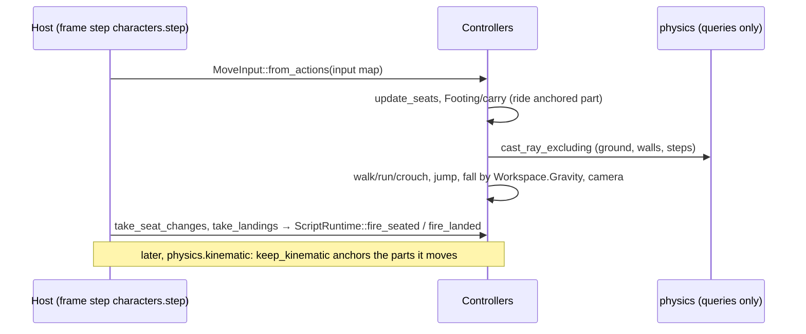
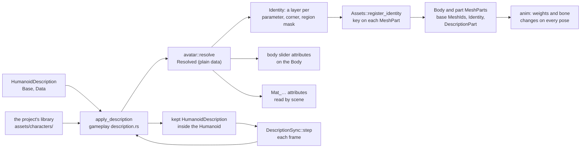

# Characters

> [!summary]
> `character` steps `ThirdPersonController` and `FirstPersonController` Instances (declared in `core`) with the same **kinematic** movement code: ray probes (`physics::cast_ray_excluding`), not a physics body. Walk, run and crouch are built-in modes; jump, slopes and step-up are movement on those modes; a custom `Movement` name hands motion to scripts. It also seats characters (Seats and VehicleSeats), rides anchored moving platforms, and provides the default character rig. Humanoids, Players and spawning live in `script` on top of it. **Implemented.** What a character looks like is separate: the **Character Runtime** (Character Studio overhaul CO3, in `gameplay`, `avatar`, `assets`, `anim` and `scene`) applies a character **description** to a character's Model; see [Applying a description](#applying-a-description-character-runtime). **Built in CO3, pending review** ([ADR-0038](../Architecture/Architecture-Decisions/ADR-0038-Identity-Is-Baked-Into-Derived-Models-Named-By-MeshId.md) is Proposed). A second base model, [the realistic base body](#the-realistic-base-body), is **built in CO4 and waits for review**; it is not yet a family characters are made from.

## Architecture and flow

- The controller of a Player's `Character`, else the first controller in the Workspace with a body, receives input and owns the camera; others walk their `MoveDirection` (Humanoids).
- A seated character is unanchored and welded to its seat; `keep_kinematic` skips it.

## Applying a description (Character Runtime)

Built in Character Studio overhaul CO3. The contract, field by field, is `docs/development/character-studio/architecture.md` (sections 7, 10, 14 to 17); the formats are [Character Data](Character-Data.md). This is how the pieces run.

- **Resolve.** `apply_description(world, assets, character, description)` (`crates/gameplay/src/description.rs`) reads the project's character library (`library`: `assets/characters/` in the project folder, read once and again when its `catalogue.json` changes) and calls `avatar::resolve` (`crates/avatar/src/resolve.rs`). The result is plain data: the body and the parts worn (the base model's eyes, teeth, brows and lashes, then one per item) as `MeshId`s, the body's shape weights, bone changes, body slider attributes, material values, and the items left out with the reason. A character with no skinned body, or a base model the library hasn't, is an error that changes nothing.
- **Fitting garments (CO9, [ADR-0035](../Architecture/Architecture-Decisions/ADR-0035-Clothing-Fits-By-Surface-Binding-With-Region-Hiding.md), [ADR-0041](../Architecture/Architecture-Decisions/ADR-0041-Shared-Base-Mesh-With-Live-Identity-Morphs-Baking-Is-Optional.md) decision 4).** `avatar::fit` binds a garment made in the body's rest pose to the body (where a ray inward along the garment's normal meets it, or the closest point), carries the skin weights of the skin under it (smoothed over the garment) and every identity and corrective shape onto it as same-named morph targets, and pushes it out of the body and lower layers along their normals at rest, at each shape's full weight and at the sliders check's pairs of build extremes. The result is an ordinary skinned part that follows the body's live weights; nothing is fitted at run time. `import_garment` (and `cargo run -p axcenity-avatar --example import_garment`) aligns a glTF or OBJ garment, classifies its slot from the regions it covers, writes a fitted `.glb`, its binding, a thumbnail and a draft item manifest into a library. A region counts as covered at 99.5% of its triangles, a triangle being under the garment when the garment lies out along its normal or it is in a crease the garment closes over (`coverage::closed_creases`: the armpit under a sleeve); it is hidden only if its skin also stays under the cloth in every fit pose (`pose_safe_hides`, CO9 part 2 review fixes 2: hiding the test tee's torso and upper arms left holes in the walk, so it hides only the waist). `player`'s `fit_gate_tests` measure poke-through on the cast in the body suite's poses, layered pairs (a lower layer through an upper one) and holes (hidden skin out from under the cloth, the same rule); `player`'s `garment_checks` are the helpers a content track calls on its items for asset-quality §3 and §4 in motion and on the feet: `motion` (sampled frames of Idle, Walk and Run: no garment corner jolting past the skin near it, no seam opening, no hair inside the head) and `footwear` (no foot corner out of the shoe, the tread flat on the floor at rest).
- **Live identity (refinement R2a, [ADR-0041](../Architecture/Architecture-Decisions/ADR-0041-Shared-Base-Mesh-With-Live-Identity-Morphs-Baking-Is-Optional.md)).** The resolved `Identity` has one layer per parameter, corner and region mask. The applier registers it in `Assets` (`Assets::register_identity`, by `Identity::key`) and writes its key on the body and every part as the attribute `Identity`; every MeshPart keeps its base model's `MeshId`, so all characters of a family share one mesh. A part with item parameters wears the body's identity plus a layer of the item's own shapes. `anim` works out once per model and identity how it wears it (`Model::live` → `LiveIdentity`, `crates/assets/src/model/identity.rs`; cached in `crates/anim/src/live_identity.rs`), adds its bone changes after the clips and puts its shape weights and per-joint corrections (re-seated binds, carried surfaces) on the pose last. A parameter change is a new key and new weights: no mesh is copied. **The bake is optional**: `gameplay::description::bake` gives each MeshPart the derived model of [ADR-0038](../Architecture/Architecture-Decisions/ADR-0038-Identity-Is-Baked-Into-Derived-Models-Named-By-MeshId.md) (`…#AxcenityHumanoid/Body#i<key>`, `Assets::derive`, `crates/assets/src/derived.rs`) and draws the same pixels; nothing calls it by default, a baked character stays baked where it is loaded, and applying a description makes it live again.
- **Parts.** The character's `Body` MeshPart takes the base body's `MeshId`, kept where the old model's skeleton stood (`anim::ragdoll::refit`). Each part is a MeshPart inside the `Body`, named after its object, not colliding and massless, with the attribute `DescriptionPart`. Parts already worn are kept (and keep their pose), parts no longer worn are destroyed, and MeshParts without the attribute are the creator's own and left alone, except that one named like a library part is taken over (the default humanoid's hand-placed parts). They follow the body as any follower does ([Animation](Animation.md)). An item on a socket gets an Attachment named after the socket, so `anim`'s sockets hang it; the base model's sockets the body lacks are added.
- **Attributes.** Body slider values (`BodyHeight` and the rest) are number attributes on the `Body`; one at 1 isn't written unless it undoes an earlier value. A slider attribute this base model doesn't drive, left on the `Body` by another base model, is set back to 1 (`anim::BODY_SLIDERS`).
- **An Animator.** Something must pose the body for its parts to be placed on it, so a `Body` with no Animator is given one. An Animator with nothing to play poses its MeshPart at rest when that MeshPart has MeshPart children ([Animation](Animation.md)), so a character standing still wears its parts in place.
- **Material values.** Each value is an attribute `Mat_<material>_<value>` (`crates/core/src/material_values.rs`; a number or a `Color3`) on the MeshPart whose model has the material: the base model's on the body and its own parts, an item's on its part. Values a description no longer has are removed. `scene` reads them when it builds the part's draw items (`modulate` in `crates/scene/src/material.rs`), so the material's maps stay ([ADR-0036](../Architecture/Architecture-Decisions/ADR-0036-Character-Shading-Models-With-Modulating-Material-Values.md)): `melanin`, `undertone` and `redness` tone the base colour by one ratio in linear light along a pigment curve (`crates/scene/src/skin_tone.rs`, the skin references' tone table interpolated in optical density; all three 0 is exactly the authored colour); then `tint`, `iris_tint` and `sclera_tint` multiply it; `roughness_scale` multiplies the roughness and `detail_strength` the normal map's strength. Free per item: no new texture, binding or bind group beyond a distinct normal strength. The other values are stored and wait for the renderer's shading models (CO7). Tests: `scene`'s `material_values_tests` and `skin_tone`, and the player's `skin_value_tests` (neutral values draw the same pixels as none; each drawn value moves a capture the way it means).
- **The kept description.** What was applied stays in the World as a `HumanoidDescription` inside the character's Humanoid (named `AppliedDescription` inside a character without one), so it is saved and replicated like any Instance. An `Identity` key only means something to a run that has registered its identity, so `DescriptionSync::step` applies every kept description under the Workspace that this run hasn't applied, or whose `Base` or `Data` changed since. `DescriptionSystem` (`crates/gameplay/src/description_system.rs`) steps it every frame from the game systems' step in the script step (on each side; the second finds nothing left to do) and reports a description it can't apply once. Until that step runs, the character draws its base meshes with no identity.
- **Scripts** reach all of it through `HumanoidDescription`'s methods, `Humanoid:ApplyDescription`, `Humanoid:GetAppliedDescription` (a copy) and `Players:CreateHumanoidModelFromDescription` (a copy of the StarterCharacter with the description applied): `docs/scripting/api-character.md`.
- **The library in a project.** `project::add_character_library` (`crates/project/src/character_library.rs`) writes the engine's built-in package (the stylized humanoid's manifests, `HumanoidParts.glb` and a catalogue) into a project's `assets/characters/`, keeping files already there. `project::add_default_humanoid` calls it first, so the library arrives with the default character: a new project with a character, Insert ▸ Character, Character Studio's workspace folder and the visual QA capture's stage. A project made before CO3 has none until Insert ▸ Character is used, and a packed game from such a project has none ([Known limitations](../Roadmap/Known-Limitations.md#characters)). `project::add_character_packages` copies the engine's other packages (and presets) in beside it, file by file where the shipped file is missing or differs, so an older copy is brought up to date; a folder's own files and IDs are left alone (refinement audit D2).

## The realistic base body

Built in Character Studio overhaul CO4, with its body parameters from CO5, waiting for review ([ADR-0032](../Architecture/Architecture-Decisions/ADR-0032-Semi-Realistic-Default-Character-Family.md)). The package's own README, beside its files in the repository's `assets/characters/realistic/` folder, describes the build; the contract is `docs/development/character-studio/architecture.md` (sections 6 and 12).

- **What it is.** The base model family `axcenity/realistic`: the manifest `Realistic.base.json` and the model `RealisticParts.glb`, with the skeleton `AxcenityRealistic`, the body `AxcenityRealistic/Body`, the parts `Eyes`, `Teeth` and `LipSeal` (the depth the closed lips touch over), and two simpler copies of the body (`Body_LOD1`, `Body_LOD2`) and of the teeth (`Teeth_LOD1`, `Teeth_LOD2`). Its 15 body regions (the neck's skin round the neck and a third upper-arm band to a short sleeve's end, `upper_arms_mid`, since CO9 part 2's review fixes, so a crew-neck T-shirt hides the torso and the upper arm under its sleeves) are stored twice, as the index map `RealisticRegions.png` and as the body's `TEXCOORD_1` ([ADR-0035](../Architecture/Architecture-Decisions/ADR-0035-Clothing-Fits-By-Surface-Binding-With-Region-Hiding.md); since CO9 a worn item's map regions are left out of the body drawn: `model.regions_map` in the manifest, `Assets::hide_regions`, `crates/assets/src/hidden.rs`). Its `build.py` makes all of it from Blender Studio's Human Base Meshes v1.4.1, which are CC0.
- **Skeleton.** The 56 bones of the humanoid convention, named as the stylized humanoid's are, plus 16: eight twist bones and eight helper bones, listed in the manifest's `skeleton.added_bones`. No clip keys them; `anim` turns them by name just before the skin is posed ([Animation](Animation.md)).
- **Clips.** The starter animations were made on the stylized skeleton, whose bones have the same names and other lengths. `anim` plays such a take through humanoid roles, not by name, so the realistic body keeps its own proportions ([Animation](Animation.md)).
- **Body parameters (CO5).** `frame`, `muscle` and `fat` for the whole body, `muscle_<region>` and `fat_<region>` for eight regions, and nine proportion sliders, each with its own range since R3 (decision 8): each end is the last step a sweep finds still deforming cleanly (no new crossings, joints within their limits, no collapse, no step in the outline) or the population's 0.5th or 99.5th percentile, whichever comes first (`docs/development/character-studio/refinement/r3/ranges.md`). The hips narrow as well as widen: below 1 a shape (`<Frame>_Hips_Narrow`) narrows the surface and no bone moves, because the bone pulls the thighs through each other. The muscle and fat shapes were carried over from MakeHuman's CC0 targets and are manifest corners with the frame. Since R3 `fat` also adds fat that MakeHuman's weight axis leaves out at this body's muscle (`<Frame>_Fat_Soft`: its own body-shape and regional targets, a belly and flanks on the masculine frame, hips, thighs and buttocks on the feminine), and the slight masculine body has a flatter belly (`Masculine_Belly_Flat`); see `assets/characters/realistic/README.md`. Since R3's wave 3 the waist slider moves the waist by most of its value: `anim`'s `WaistWidth` scales only the Spine bone's skin, so `<Frame>_Waist_Wide` and `_Narrow` carry the difference between that and the waist the slider means (0.82 to 0.88 of the slider's change in the natural waist's breadth, 0.3 in its depth); and `muscle` with `fat` at 1 is a strong, heavy person, not a bodybuilder (`<Frame>_Fat_Over_Muscle` covers the muscle's definition and some of its mass, and the feminine thigh no longer flares below the hips). The stylized family is held to the same body checks: its build shapes are kept apart where they crossed (at rest, with the hips narrowed and with the head scaled), its hips narrow by the same kind of shape (`Masculine_Hips_Narrow`, `Feminine_Hips_Narrow`) and its proportion ranges are its own sweep's. Six of the body's shapes are corrective shapes for the shoulder, raised and lowered, that `anim` drives from the pose ([Animation](Animation.md)); the rest are identity, worn live ([ADR-0041](../Architecture/Architecture-Decisions/ADR-0041-Shared-Base-Mesh-With-Live-Identity-Morphs-Baking-Is-Optional.md)) or baked on request.
- **Head and face (CO6).** The body's own head with 512 more vertices round the lids (`rims.py`), eyes as sclera, iris and cornea (`Eyes`) with an occlusion film and a tear line (`EyeShell`), lash and brow cards, separate teeth, gums and a tongue (`Teeth`, with its own two simpler copies) and `LipSeal`. 44 expression shapes on `Body` for the 48 standard controls (the four looks turn the eye bones; `Jaw_Open` is the jaw's turn plus a shape) through the built-in `axcenity` face profile, and 61 identity parameters in nine groups (R4 added nose tip projection and rotation, whole-nose width, philtrum length, and jaw angle, upper lid fold, lower lid, eye corner and earlobe a side), the eye ones also moving the eye bones. The feminine frame's face is its own since R4 (5% smaller about the eyes, fuller lips and cheeks), and since R4's second pass (wave 3) narrower below the brows, its chin shorter, its brow ridge and nose smaller (zy-zy 0.93 of the masculine; the frames' faces differ by 4.8 mm RMS), while the masculine frame's glabella stands 1.5 mm further forward; the brows are cards drawn hair by hair in a dark brown from melanin, fuller on the masculine frame and thinner, shorter and more arched on the feminine one, within 2 SD of F-29's length. Every shape is made procedurally in Blender (`face.py`, `lids.py`, `mouth.py`, `teeth.py`, `faceparams.py`); the mouth is mirror-symmetric by construction. `assets/characters/humanoid/qa/face_checks.py` poses every control, viseme, expression and identity end (R4's identity ends also under every expression and viseme, and alone and with every other identity end for new crossings of the head's skin, `identity_pairs`) and holds the lids off the eyes and the teeth out of the lips. `measure.py --only sliders` sets every pair of parameters to their ends and moves the eye bones by their `bones` drivers, as `avatar::resolve` and the bake do. What they measure and what the engine shows are in `docs/development/character-studio/co6/README.md`.
- **Underwear and brow length (2026-11-16).** Boxer briefs, briefs and a sports bra cut from the body's surface (`underwear.py`), worn by the `frame` parameter's choices (Male, Female) and always on (Character Studio has no control for them, and the runtime puts them on and refuses a script that takes them off), and a brow length parameter that moves the brows' card. Character Studio offers only this body for new characters.
- **Handles (refinement R2).** The manifest's 19 `handles` (nose, eyes, jaw, mouth, shoulders, waist, hips) are points of the skin that Character Studio draws on the selected feature and drags: each names the parameters it moves, with the axis and travel `handles.py` measured on the model (the player's `handle_tests.rs` holds them to the applied skin within 5%, each anchor within 2 mm of a skin corner at rest, and the handle the data predicts at its parameters' ends, its anchor where the start draws it plus axis × travel × the share moved, within 2 mm of the applied skin on both frames). Picking a feature reads the skin as drawn: `scene`'s `ray_parts` and `ray_model` test a ray against each part posed, skinned and morphed with its live identity (the CPU skinning `Posed::primitive` keeps per pose), and report the body region hit from the build's region map, which `assets` reads from the body's second texture coordinates into `Primitive::regions`. The studio draws the handles and the hovered feature's tint only where the camera sees the skin (a CPU depth buffer of the posed character, `crates/editor/src/character_workspace/direct/depth.rs`), so a far-side handle is neither drawn nor grabbed. The studio's side is `docs/editor/character-studio.md`, "Editing on the character".
- **Not yet a full character family.** It has no hair or clothes beyond its underwear. The library `project` writes into a project is still the stylized package alone (`crates/project/src/character_library.rs`). What it measures against its targets, and what is still short, is in [Known limitations](../Roadmap/Known-Limitations.md#characters) and `docs/development/character-studio/testing.md`.

## Dependencies

`core`, `anim` (seat `Sit` state), `assets`, `physics`. **`physics` must never depend on it**; `nav` may. The Character Runtime is not in the `character` crate: the applier is in `gameplay`, which depends on `avatar` for it; `avatar` itself makes no Instances.

## Performance

**Measured** (S10k, 9950X3D): Characters was 2.70 ms with one player character (ray probes against 10,000 parts); after L4's kept query bounds the test runner's Characters step is 0.31 ms (cloud container). See [Optimization log](../Performance/Optimization-Log.md#l4-query-bounds).

## Testing

`crates/character/src/tests.rs`, `tests/seat.rs`; player tests `seat_tests.rs`, `vehicle_tests.rs`, `spawn_tests.rs`, `humanoid_tests.rs`, `default_humanoid_tests.rs` (the default humanoid asset). The Character Runtime: `avatar` `tests::resolving`; `assets` `model::identity::tests` and `derived::tests`; `crates/gameplay/src/description_tests.rs` (changing a description, and scripts doing it on both sides); the player's `default_humanoid_tests/description.rs` (parts worn, identity worn live and changed by weights only, item parameters as live weights, eyes carried by the frame's bones, an explicit bake within 0.2 mm of the live character, body sliders, material values, a kept description applied again) and `default_humanoid_tests/description_lua.rs`; the editor's `a_character_file_applied_in_a_game_matches_the_workspaces_preview` (the applier and Character Studio's preview put every corner in the same place, to 0.2 mm, with no derived `MeshId`); direct manipulation (R2): `scene`'s `surface_pick` tests (a ray at a known point of the posed body hits within 1 mm, the identity's weights change the hit, a miss is none), `assets`' region map tests, `avatar`'s `realistic_handles`, the player's `handle_tests.rs` (every anchor on the skin at rest; every handle the data predicts within 2 mm of the applied skin at its parameters' ends; every travel within 5% of the applied skin's) and the editor's `character_workspace::handle_tests` (a handle's drag and the sliders give the same description for each of the seven features, one undo step, camera drags change nothing, Symmetry moves the mirror); the capture's `an_explicit_bake_draws_the_same_pixels_as_the_live_character`. Visual QA: `crates/player/src/character_capture.rs` draws a character from a description file with the player's renderer (six fixed cameras, two lighting presets; the `capture_characters` tool), the same input giving the same pictures; beside the fixed set, added for the refinement and drawn only when named: the `warm`, `cool` and `outdoor` lights, the `face-three-quarter`, `face-side` and `skin-close` views, four held QA poses and the `face` and `body` suites (a sheet per character). The benchmark characters are `assets/characters/benchmarks/`, with a cast of representative people per family and frame (`docs/development/character-studio/visual-qa.md`). The realistic body is measured and rendered in Blender (`measure.py` and `render_baseline.py` with `--package realistic`, held to the package's `qa/thresholds.json`); its numbers are `docs/development/character-studio/co4/measurements.json`, with its sheets beside that file.

## Limitations

Since CO8 (2026-11-17) the renderer morphs and skins each character once a frame, walking only the shapes with a weight, and every pass and ray tracing read that posed copy: live identity costs once, not per pass (1, 10, 20 and 50 characters before and after in `docs/development/character-studio/refinement/wave3/co8-compute-posing.md`; 50 live take 1.5 ms of GPU against 9.6 ms before), and ray-traced shadows, ambient occlusion, reflections and hardware GI show identity and expression shapes. Registered identities are kept for the run, one per drag step since the drag throttle went. The rest of the Character Runtime's limits (the editor's edit mode, values not drawn until CO7, no content yet for binding-fitted and socket items) are in [Known limitations](../Roadmap/Known-Limitations.md#characters), with the realistic base body's (the raised shoulder held by its ring area, not its local volume).

## Development guidance

- Never change physics settings from here; fall by `physics::gravity(world)`.
- A new movement feature works in both controllers (only `Eye` and `pose_camera` differ).
- A character with a root part (its Model's `PrimaryPart`, else `HumanoidRootPart`) is measured by that part alone (`root_part`, `Body::rooted`): walls, ground, steps, crouch and feet use its box, every part still moves and turns with it, and a crouch squashes only it. That keeps a skinned mesh in an A-pose from widening the body.
- The default character is the skinned default humanoid (`project::default_character`, stage HD3 of `docs/research/default-humanoid.md`; smooth stylized since Character Studio CS1, [ADR-0030](../Architecture/Architecture-Decisions/ADR-0030-Smooth-Stylized-Humanoid-On-CC0-Base-Meshes-With-Mask-Shapes.md), superseded for the overhaul by [ADR-0032](../Architecture/Architecture-Decisions/ADR-0032-Semi-Realistic-Default-Character-Family.md) while this asset stays shipped and is described by [Character Data](Character-Data.md)'s `axcenity/stylized` manifest: its `Humanoid.glb` keeps the 41 face shapes and the clothing masks its outfit needs, resting at 1): an invisible `HumanoidRootPart` (the 0.30 m capsule's box, 0.86 × 5 studs) with the `Body` MeshPart welded to it, not colliding. Insert ▸ Character in a saved project and new projects from the character templates (StarterCharacter `assets/prefabs/Character.prefab.json`) use it; the six welded blocks (`rig.rs`) remain for unsaved projects and an empty StarterCharacter. Known gap: in first person the camera sits inside the head, whose eyeballs can show; hiding the head comes with modular parts (HD4).

## Related documentation

`docs/scripting/api-character.md`; `docs/development/character-studio/architecture.md`; [ADR-0007](../Architecture/Architecture-Decisions/ADR-0007-Fixed-Step-Physics-And-Kinematic-Characters.md); [ADR-0033](../Architecture/Architecture-Decisions/ADR-0033-One-Character-Description-Read-By-Every-Host.md); [ADR-0038](../Architecture/Architecture-Decisions/ADR-0038-Identity-Is-Baked-Into-Derived-Models-Named-By-MeshId.md); [Character Data](Character-Data.md); [Gameplay systems](Gameplay-Systems.md); [Physics](Physics.md); [Animation](Animation.md)
