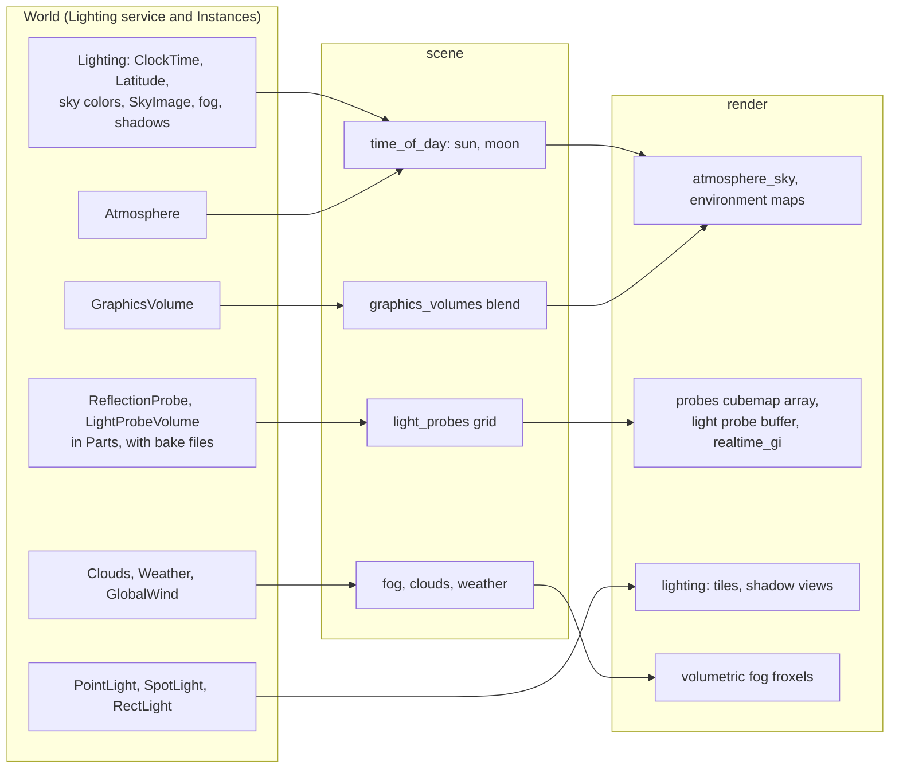

# Lighting and atmosphere

> [!summary]
> How a world is lit: the sun and moon placed by **time of day**, a gradient sky or a physically based **Atmosphere** (Hillaire 2020 scattering, worked out on the CPU) or a sky image, **environment maps** baked only when the sky changes, baked **reflection probes** and **light probe volumes** (indirect light without lightmap UVs), optional **real-time GI** that re-traces a few probes a frame, tiled **point/spot/rect lights** with optional shadows, **fog** (distance, height, volumetric froxels with sun shafts), **clouds**, **weather** and **graphics volumes** that blend a place's look around the camera. **Implemented**; real-time GI is opt-in (off at every preset).

All of it follows the "look vs cost" split ([ADR-0013](../Architecture/Architecture-Decisions/ADR-0013-Look-Versus-Cost-Settings.md)): the creator's Lighting Instances say what the world looks like; the machine's settings cap what it costs. Defaults reproduce the old fixed sun and sky exactly.

## Architecture

## Key facts per feature

| Feature | How | Cost control |
|---|---|---|
| Sun shadows | Cascades (High: three 2048² layers), texel-snapped spheres, casters 500 studs toward the sun; PCSS soft shadows (16+16 Poisson samples); fade over the last 20% | Shadow quality Off→Ultra; far cascades alternate frames past 12,000 casters |
| Spot / point shadows | Per-light maps; `near` offset so a lamp doesn't shade its own beam | Count and size by shadow quality |
| Contact shadows | Screen-space, need the prepass depth | High and Ultra |
| Environment | Sky baked into a cubemap only when it changes; GGX-filtered mips; spherical harmonics on the CPU | Reflection quality Low (analytic, no maps) → Ultra (256²) |
| Default sky | New Baseplate and Empty projects get a CC0 Poly Haven HDRI (`project/src/default_sky.rs`, 2K `.hdr`, 5.4 MB) as `SkyImage`, with `ClockTime` and latitude set to its sun | A project file like any sky; exported with the game |
| Reflection probes | Editor bakes a cubemap at a part's middle; used inside its box with `BlendDistance` | Left out at Low |
| Light probe volumes | Grid of probes in a part's box (`Spacing`, max 16 a side); diffuse indirect light | Bake fingerprint warns when stale; the editor's Light Probes overlay (R18.1) shows each probe's baked light and each volume's bake state; probes baked inside a solid are invalid and left out of the blend (R18.2); the sky's share of each probe's light is baked apart and scaled by the sky drawn now, so a dimming or tinted sky relights volumes without tracing (R18.3); Bake Probes runs about 30 ms a frame (`editor/src/app/probe_bake.rs`, one `LightProbeBaker` for every volume) with a progress window and Cancel, so a big bake no longer freezes the editor; Fill with Probes (R18.4) sizes a volume to the selection within 512 probes |
| Real-time GI | Re-traces the preset's tier of probes each frame with a kept `ProbeCamera` (R18.4 `RealtimeGiTier`: Low 1 at 8² faces, Medium 2 at 8², High 2 at 16², Ultra 4 at 16²) | `realtime_gi` setting, off by default |
| Height fog | An Atmosphere's exponential height fog, exact along each ray (`fog_transmittance`): `FogDensity` (the fog alone, the sky untouched), `FogHeight`, `FogFalloff` and `FogStart` (the foreground kept clear; the volumetric grid takes only the share of each slice past it) since 2026-11-26, for Overgrown Street's ground mist, fading into a creator's sky image's own horizon where one is drawn (it took the atmosphere's clear-sky blue before); before, its falloff was fixed at 50 studs and it started at the camera | None: the same per-pixel work; the start rides in a spare uniform slot |
| Volumetric fog | Froxel grid in compute: sun shafts from 8 shadow samples a cell (4 rays with ray traced shadows), shifted through the cell each frame and averaged with the reprojected last frame's grid (2026-11-14), shown through a cubic B-spline upsample, height fog's own light by how open the air is (light probes), dust in up to 8 GraphicsVolume boxes at once (FogEffect `Density`, `HeightFalloff`; since LE2 of the 2026-11-13 lighting audit, Insert > Fog Volume), and Interior boxes (FogEffect `Interior`) that clear the world's fog inside them | Setting |
| Weather | Lighting's `Weather`: rain or snow sprites in a box round the camera, culled under roofs by a 64×64 sky-visibility field of top-down rays against collision (`scene/src/weather.rs`), and `weathered` in lighting.wgsl on every lit surface: wet surfaces darker, deeper and glossier with puddles on level ground; while rain falls its drops ring the water (`rain_dimples`), splash where they land and drip from roof edges (CPU sprites from the same rays and field); snow with a ragged edge, grain and glints, lying on plants by their crown's shape (`weathered_lying`) and on terrain as deep as `SnowThickness` (vertex lift in terrain.wgsl), banked against what stands in it (the field's `bank` channel), and as a slab on solid items (`snow_cap`, the meshes' skirts); the prepass keeps the wet roughness so ray traced reflections trace wet surfaces and terrain's puddles (2026-11-23). A `WeatherVolume` (an invisible Part in the Workspace) sets the weather in its box by hand, in place of that shelter: `scene/src/weather.rs` (`weather_volumes`) reads them into `DrawList::weather_boxes`, `frame_uniform` packs the 8 nearest into `Frame::weather_boxes`, `weather_sample` blends each box's `Snow` and `Wetness` shares (0 to 2) over the exposure, and `WeatherState` culls or lets fall the drops inside by its `Precipitation` (2026-11-23). What touches the snow presses its own shape into it (`scene/src/weather/prints.rs`, 2026-11-23): for each colliding Part or MeshPart that moved or lies unanchored, and each foot of a character (a skinned body's foot sockets, else a print a stride at its leg parts), a ray that passes the thing by finds the ground under it, the snow's surface is that ground lifted by the snow's depth there, and the part of the thing's shape under that surface (a box's clipped outline, a ball's circle, a cylinder's strip or disc, a MeshPart's box) is stamped, swept from where it was last update, as deep as its lowest point has sunk. The stamps go into a fine map round the camera (`render::WeatherPrintCells`: 512 × 512 cells of an eighth of a stud, two 12-bit numbers a cell, kept after the field's cells in the same storage buffer and described by `Frame::weather_prints`); cells hold depth plus the filling-in clock at stamping, so they change only where something presses and the renderer writes only changed rows. `weather_print` reads it through a 3 × 3 B-spline for the snow's normal, packed floor and wall shade on any snow-covered surface; the field's footprint channel is each stud's average, which presses the terrain's corners. Characters and parts touching the snow are no roofs to the sky-visibility field while prints are on (its rays are cast again past them), so no bare, banked patch trails what moves. Lightning (`Weather.Lightning`, 2026-11-23) is worked out in lighting.wgsl from the clock alone (`lightning`: a chance of a flash each 2.6 seconds, as `Frame::noise.z`): most of a flash's light comes the sun's way and takes the sun's shadow without the clouds' (`lightning_light` in `shade_surface`), the rest from the whole cloud overhead by the weather's shelter, and the cloud glows round the stroke (`lightning_sky`). The wind drives lying snow onto what faces it (`snow_driven`) and runs spindrift along the ground (sprites on the flakes' places, set on the sky-visibility grid's heights) ; and under broken to overcast cloud the sky's light is the clouds' grey, not the clear sky the environment maps hold (`under_clouds` inside `sky_diffuse` and `sky_specular`, by the world's `Cover` and the layer's depth) | No pass, target or draw call beyond the sprites; skipped on one uniform test when dry and bare. Lightning and wind-driven snow, Measured 2026-11-23 on the Desktop (RX 9070 XT, radv, ignored test `weather_looks_cost`, `--release`, 1080p, median GPU frame): a storm 3.87 ms without and 3.85 ms with a flash every beat, snow 3.71 ms in still air and 3.75 ms in a gale (clear 1.32 ms, the overcast's cloud layer alone 2.73 ms). Prints, Measured 2026-11-23 on the Desktop (Linux, radv, other builds running; ignored tests `prints_cost`, `prints_cost_against_the_world`, `print_map_upload_cost`): about 0.1 ms an update for 20 dragged parts and 4 walking characters on a test ground, 0.2 to 0.27 ms against physics among 2,020 parts; 29 KiB of the 1 MiB map written an update, 40 to 70 µs to write it whole |

## Environment presets

The look of the sky and the weather under one name, blended from one to the next (2026-11-23; `crates/anim/src/environment.rs`, `docs/project/sequences.md`). It's in `anim`, not `scene` or `render`, because it only reads and writes World properties and the dedicated server links it through `script`.

- **A preset** (`EnvironmentPreset`) holds values of Lighting (`ClockTime`, `Exposure`), of the first Atmosphere, Clouds, Weather and ColorCorrectionEffect in it, and the Workspace's `GlobalWind`: any number, color, vector, switch or keyed choice those classes have. A value left out isn't touched. Six are built in (Clear, Evening, Overcast, Storm, SnowDay, SnowNight); a project's own are `assets/environments/<name>.environment.json`, found first by name (`find_preset`).
- **`blend(a, b, t, turn)`** is pure: numbers, colors and vectors linearly, switches and choices at half way, `ClockTime` round the clock (the short way, forward or backward), and rain to snow through an intensity of 0, so the two never fall together. Nothing falling counts as 0 of the other's kind, so rain starts and stops gently.
- **Three users, one code path.** A sequence's Environment track (`EnvironmentTrack` inside `SequenceRun::apply`, so the game, the Sequencer's preview and Render Movie agree), `Lighting:TransitionToPreset(name, seconds, clock)` (`crates/script/src/environment.rs`: one transition at a time, shared by both sides, stepped in `ScriptRuntime::step` before the Sequences) and the editor's Properties section (`crates/editor/src/environment_presets.rs`: apply and save, one undo step each).
- **Precedence**, fixed and tested: a property track on a property beats the Environment track for that property (the track doesn't write it at all); a playing sequence beats a script's transition (it's applied after it each frame); a later `TransitionToPreset` replaces an earlier one from where the world is.
- **The Weather's `TransitionTime` is untouched.** Presets set the Weather's properties, and `WeatherState` still follows them by at most one whole change per `TransitionTime`: a slower blend is followed exactly, a quicker one or a scrub lags. Setting it to 0 follows exactly.

## Integration

`scene` reads the Lighting service and its Instances into `DrawList` fields (`sky`, `sun`, `fog`, `clouds`, `weather`, `wind`, `lights`, probe data); `render` draws them. Bakes are editor actions (`editor/src/app/probes.rs`) writing files under `assets/probes`, packed into built games.

## Performance

- **Measured** (3f2fc05, 1440p Ultra forest): soft sun visibility through leaves takes 4 filtered samples instead of a second 32-sample soft shadow (0.6 ms saved). Far cascades on alternate frames when casters exceed 12,000 (they held 11.3 of 14.3 M shadow triangles).
- **Measured** (rendering baseline): shadows are the largest GPU pass in heavy scenes (43–52% before culling).
- Owner's projects note "Ultra and real-time GI are still heavy at 1440p" (project memory; see [Hardware notes](../Performance/Hardware-Notes.md)).

## Testing

`render/src/renderer/tests/environment_maps.rs`, `reflection_probes.rs`, `light_probe_volumes.rs`; `render/src/atmosphere.rs` unit tests; `scene/src/time_of_day.rs`; `player/src/time_of_day_tests.rs` (GPU). `graphics` must stay within its references at every preset.

## Limitations

- Lights are tiled in 2D, not clustered; depth-heavy scenes may need clusters (`docs/rendering/lights.md`).
- Rect lights light from a representative point, not a true area integral.
- Bakes go stale when the world changes; the editor flags them but doesn't rebake automatically.
- Real-time GI draws six faces of the whole scene per probe. With hardware ray tracing, RT2 updates the same probes by rays instead, with camera cascades; GPUs without ray tracing trace the same probes' rays in software since RL3 (`renderer/ray_soft.rs`: CPU-built BVHs of each mesh's simplest level of detail in one storage buffer; no posed characters, plants traced still, cut-outs' holes guessed; `docs/research/runtime-lighting-parity.md`). Its cost against hardware awaits the shared benchmark.
- Reflections come from baked reflection probes and the sky, except with hardware ray tracing: since RL4 (`RayTracedReflections`, off at every preset) glossy solid surfaces under a roughness cutoff trace one mirror ray a pixel (Low at half size) into frame binding 18 (`renderer/ray_reflections.rs`), fading into the probes toward the cutoff. Rays aren't spread by roughness (no denoiser needed, but no blurry ray traced reflections), and see-through parts, water (its own LE5 rays) and terrain keep the probes, but for terrain's puddles in the rain, which the prepass marks smooth (2026-11-23). Prepass normals' w carries 1 plus roughness for plain solid pixels since then. Cost awaits the shared benchmark.
- Played games: every ray traced effect runs in the player, but until RL2 a game can't turn hardware ray tracing on (only the player's own `graphics.json` can), and posed characters are left out of the ray traced scene until RL1, so with ray traced shadows on they cast none within the ray tracing distance. The Path Traced view is an editor reference mode, not a runtime feature.
- Probes inside solid parts and the ground are left out since R18.2, but a wall thinner than the gap between probes can still leak (probe visibility is a later stage), Since R18.3 a sky that dims or changes color relights volumes baked since, but a sun that moves (its direct light's bounce) still needs real-time or ray traced GI, and bakes from before keep the sky as baked. R18.4 added Fill with Probes and real-time GI tiers; `bench_light_probes` measures bake, volume and tier costs (PC numbers pending). What's left of R18 (`docs/research/global-illumination.md`) is probe visibility, only if leaks remain, and RT2.

- Weather is sheltered by what collides: a MeshPart counts as a roof by its convex hull unless its model has `_COL` collision pieces, so a house needs pieces for its roof, walls and floor for rain and snow to reach its terrace and not its rooms. Snow has depth on terrain and on solid items (their up-facing corners are lifted and a skirt of extra indices is the slab's sides, `renderer/snow_caps.rs`); it has none on cut-outs, leaves, swaying, posed or see-through items, and the slab isn't in shadows or ray tracing. Rain's rings, the snow's grain and its glints are procedural in world space (`docs/rendering/weather.md`). Where that shelter is wrong a `WeatherVolume` overrides it, with its own limits: at most 8 are drawn (the nearest the camera), and its rain falls under a roof but still splashes on top of it. Prints in the snow are kept by X and Z only (one under a bridge shows on the bridge's snow too), at an eighth of a stud (a foot is two or three cells wide), within 28 to 36 studs of the camera (the map's edge) and for things within 48; a MeshPart, a wedge and a tipped cylinder press as the box round them; a print has one depth (its thing's lowest point); the snow's depth under a thing leaves out the terrain's drifts; only the terrain's corners are pressed down (by each stud's average), the shape is shading; and a character's feet are read from the world, so they print where they're posed only for a skinned body with `LeftFoot` and `RightFoot` sockets.

- Environment presets hold no text (a `SkyImage`) and never make Instances at run time: a preset's clouds, weather or haze do nothing in a world whose Lighting has no Clouds, Weather or Atmosphere (warned once). There are no events for a transition starting or ending.

## Related documentation

`docs/rendering/sky.md`, `lights.md`, `shadows.md`, `fog.md`, `clouds.md`, `weather.md`, `wind.md`, `volumes.md`, `water.md`; [Rendering](Rendering.md)
