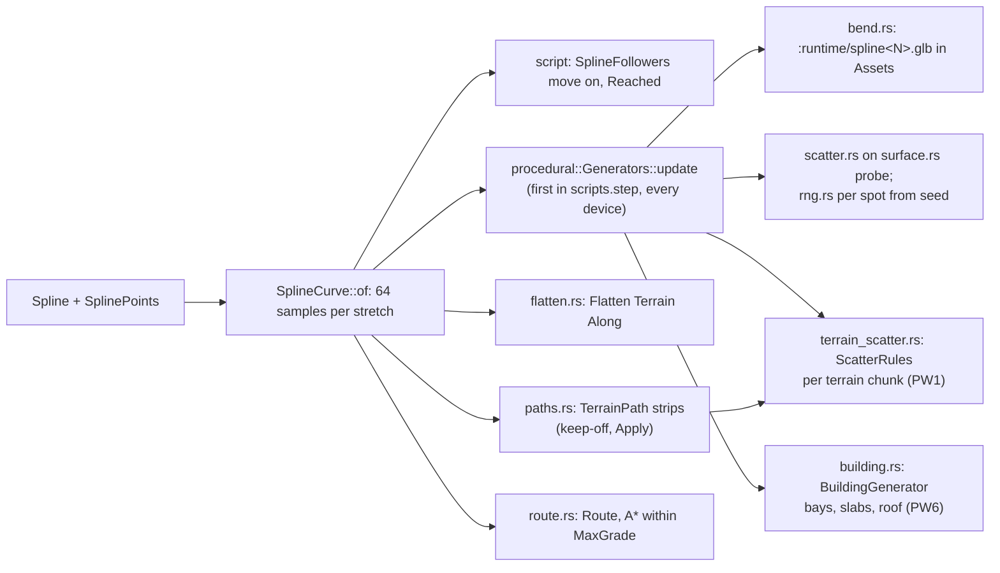

# Splines and procedural

> [!summary]
> A **Spline** is a curve of cubic Bézier stretches through its **SplinePoint** children (Auto, Linear or Free tangents), measured into an even-speed length table (`core::spline`, shared by `script`, `nav`, `anim` and `net`). **SplineFollowers** carry parts along it (server-side), NavigationAgents patrol it, Sequence cameras ride it. `procedural` makes what **SplineMeshes** (a model bent along the curve) and **SplineScatters** (models along or inside it, standing on the surface below) generate, keeps it up to date (`Generators::update`) and flattens terrain along a spline. A **TerrainPath** in a Spline (PW4) keeps terrain scatter rules off its strip (thinning them out beside it) and, in the editor, is applied (flatten, paint the road and a ragged shoulder, clear painted foliage) or routed over hills within a grade. A **BuildingGenerator** (PW6) makes a building of parts from a footprint (its own box, or a Spline's corners) and a seed. Generated children are never saved, sent or kept in slots: every device makes them from the same settings and seed. **Implemented.**

## Flow

## Development guidance

- Deterministic: the same spline, settings and seed give the same layout; use `rng.rs`, never `rand`; never iterate a `HashMap` into output.
- Anything that saves, sends or snapshots the tree must leave generated children out (`core::spline::is_generator`).
- Terrain scatter rules (PW1) keep their results in `TerrainData`'s generated chunks, not as children; see [Terrain](Terrain.md).
- A BuildingGenerator is a generator with its own `Position`, `Orientation` and `Size`, so the transform handles move its footprint; `viewport::movable_parts` leaves out anything a generator made.
- A TerrainPath is a setting, not a generator: its keep-off is live, but Apply and Route change saved data (heights, paint, painted foliage, points) and are editor undo steps.
- Since 2026-11-23 a path blends into the ground instead of ending at a line (`paths.rs`): Apply paints a `ShoulderLayer` from the road's edge out over `Falloff` (`PathSettings::paint_amounts`; the road's own layer blends into it over the first quarter), breaks the paint's outer edge up with noise by world position (`EdgeNoise`, `NoiseScale`, `edge_reach`; heights are never ragged), and takes painted foliage off the strip (`clear_foliage`). Scatter rules and painted foliage thin out over `ClearFalloff` past the strip (`KeepOff::clears`, `scatter_kept`), each spot or instance kept by a number hashed from its own position (`spot_roll`), never by a sequence, so every device thins the same spots and applying twice takes no more. `EdgeNoise` 0 and `ClearFalloff` 0 are the earlier behaviour (and the earlier strip hash); their defaults are 0.5 and 4.
- `decal_scatter.rs` is layout only (which decals one brush stamp makes, their spacing and their budget against the renderer's decal limits); the editor makes the ProjectedDecal Instances. It's here because it stands things on `surface.rs`'s probe and uses `rng.rs`; the game doesn't run it. See [Specialized editors](../Editor/Specialized-Editors.md#scatter).
- `procedural` depends on `core`, `assets`, `terrain` only, so the server and player share it.

## Related documentation

`docs/architecture/splines.md`; `crates/samples/projects/splines`, `crates/samples/projects/roads`, `crates/samples/projects/buildings`; [Terrain](Terrain.md), [Networking](Networking.md); the procedural worlds plan (scatter rules, biomes, presets, roads, buildings, mesh terrain proposal): `docs/research/procedural-worlds.md`
